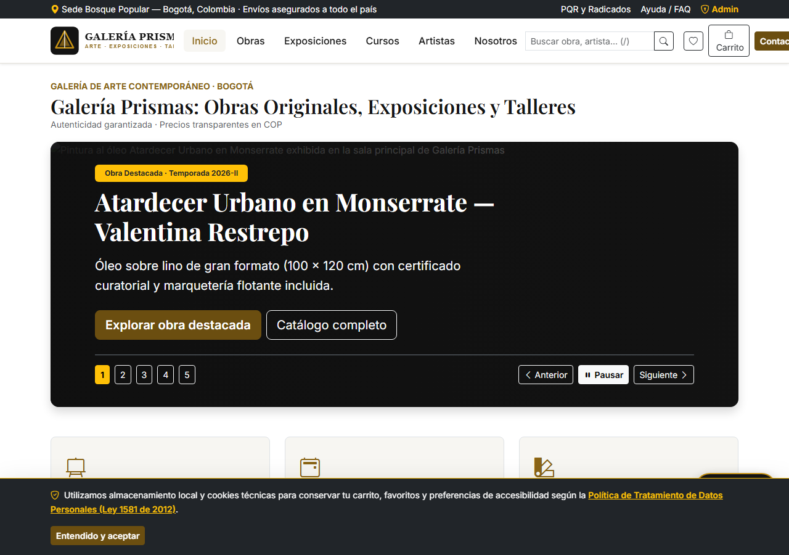
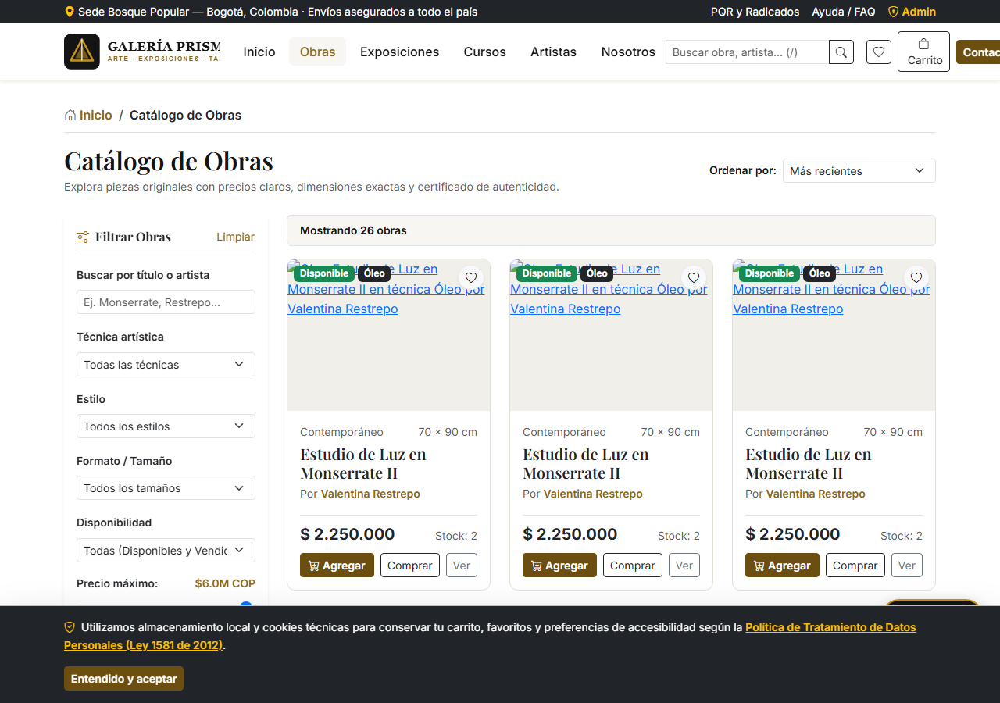
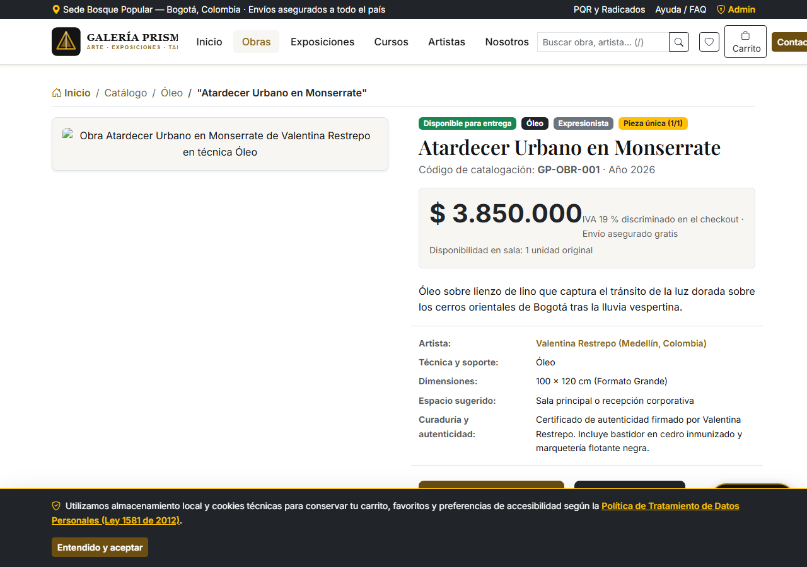
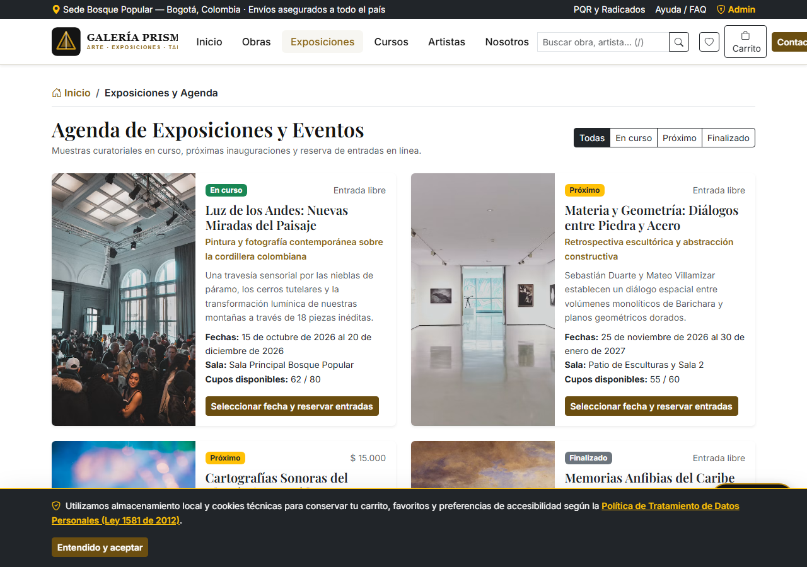
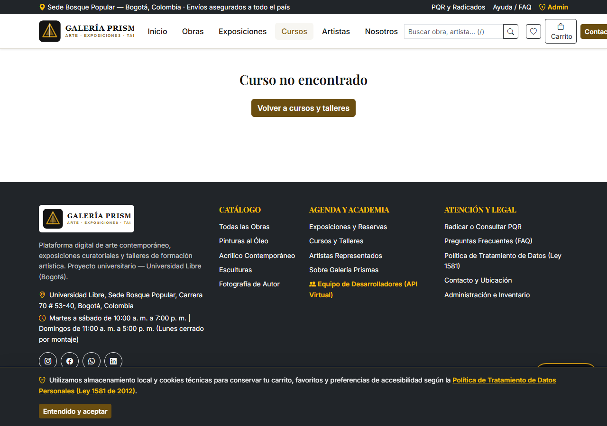
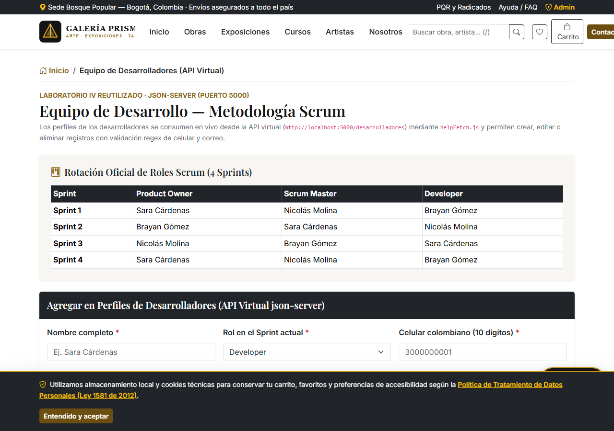
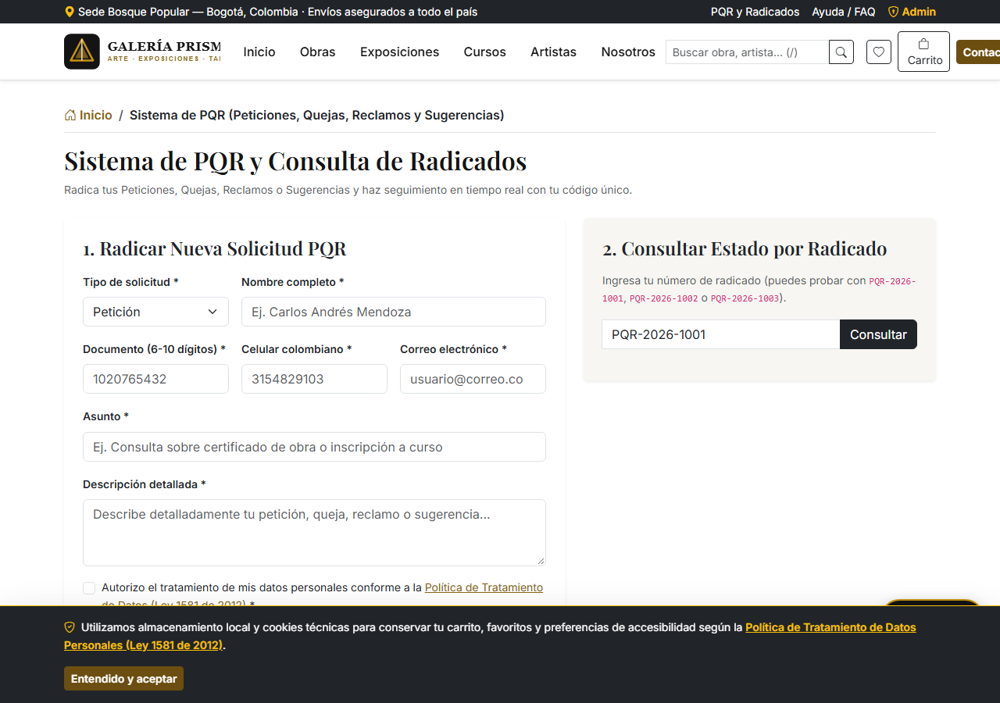
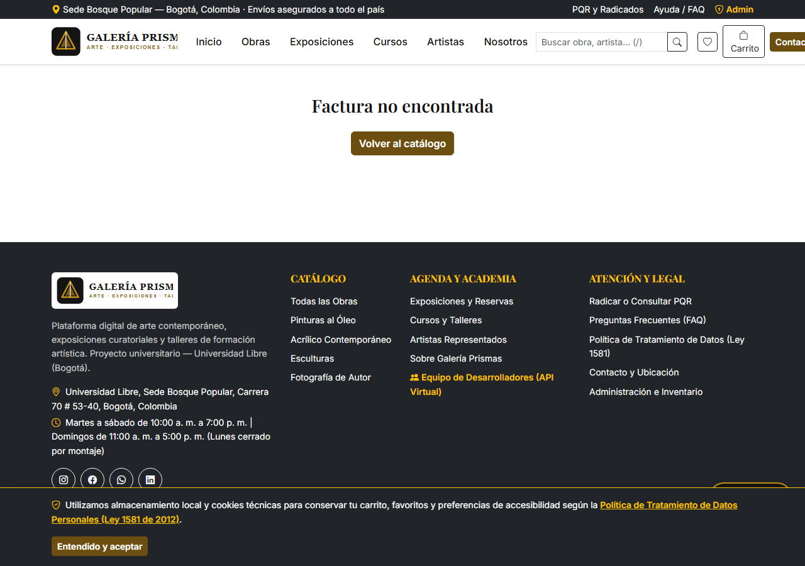

# Galería Prismas — Plataforma Integral de Arte, Exposiciones y Talleres


**Galería Prismas** es una aplicación web full-stack desarrollada como proyecto final conjunto para las asignaturas **Programación Web** y **Arquitectura de Información** del programa de **Ingeniería de Sistemas** en la **Universidad Libre (Sede Bogotá, 2026-II)**.

Resuelve la desorientación que sufren los compradores casuales de arte (**Persona 1: Carlos, 34 años**) y los estudiantes de talleres artísticos (**Persona 2: Valeria, 22 años**) mediante una arquitectura de información clara que separa tres pilares: **venta de obras originales certificadas**, **agenda de exposiciones con reserva de entradas** e **inscripción a cursos y talleres prácticos**.

---

## Capturas Reales de la Plataforma Funcionando

| Figura 1. Inicio y Slider Publicitario Accesible (`/`) | Figura 2. Catálogo con Filtros Laterales (`/obras`) |
| :---: | :---: |
|  |  |

| Figura 3. Ficha Curatorial y Obras Relacionadas | Figura 4. Exposiciones y Reserva de Entradas |
| :---: | :---: |
|  |  |

| Figura 5. Cursos, Materiales e Inscripción | Figura 6. Equipo Desarrollador (API Virtual `json-server`) |
| :---: | :---: |
|  |  |

| Figura 7. Sistema PQR y Consulta por Radicado | Figura 8. Factura Electrónica Imprimible en PDF |
| :---: | :---: |
|  |  |

---

## Tecnologías y Arquitectura de 3 Servicios

| Servicio | Puerto | Tecnologías Principales |
| :--- | :---: | :--- |
| **Frontend SPA** | `5173` | React 18, Vite 5, React Router DOM 6, Context API (`AppContext`), Bootstrap 5, Bootstrap Icons, Vitest + Testing Library |
| **Backend API REST** | `4000` | Node.js, Express.js (`/api`), Prisma ORM, SQLite (`dev.db`), JWT (`jsonwebtoken`), `bcryptjs`, `express-validator`, `helmet`, `cors`, `morgan`, `express-rate-limit`, Jest + Supertest |
| **API Virtual Desarrolladores** | `5000` | `json-server` (`/desarrolladores`) consumido con `helpFetch.js` y el CRUD genérico reutilizado del Laboratorio IV |

---

## Requisitos Previos

- **Node.js:** `v18.0.0` o superior (probado en `v20+` y `v26 LTS`).
- **npm:** `v9.0.0` o superior.
- **Git:** `v2.30+`.
- **Base de datos:** **No requiere instalar ningún motor externo** (usa SQLite embebido gestionado automáticamente por Prisma).

---

## Instalación y Ejecución en un Computador Nuevo (Un Solo Comando)

```bash
# 1. Clonar el repositorio
git clone https://github.com/SCCUBILLOS/galeria-prismas.git
cd galeria-prismas

# 2. Instalar dependencias de la raíz, backend, frontend y api-virtual automáticamente
npm install

# 3. Levantar los 3 servicios, crear .env si no existe, aplicar migraciones y sembrar datos automáticamente
npm run dev
```

Al ejecutar `npm run dev` estarán activos:
- **Sitio Web (Frontend):** [http://localhost:5173](http://localhost:5173)
- **API REST (Backend Express):** [http://localhost:4000/api/health](http://localhost:4000/api/health)
- **API Virtual de Desarrolladores (`json-server`):** [http://localhost:5000/desarrolladores](http://localhost:5000/desarrolladores)

---

## Scripts Disponibles desde la Raíz

| Comando | Descripción |
| :--- | :--- |
| `npm run dev` | Verifica `.env`, aplica migraciones SQLite, siembra la base si está vacía y levanta los 3 servicios en paralelo con `concurrently`. |
| `npm run seed` | Ejecuta nuevamente la semilla (`backend/prisma/seed.js`) con 22 obras, 6 artistas, 5 cursos, 4 exposiciones, 3 clientes, 3 proveedores, 3 pedidos y 3 PQRs. |
| `npm run reset-db` | Reinicia la base de datos SQLite desde cero y vuelve a poblarla con los datos iniciales. |
| `npm test` | Ejecuta las pruebas automáticas de integración del Backend (`Jest + Supertest`) y las pruebas unitarias/componentes del Frontend (`Vitest + Testing Library`). |
| `npm run build` | Genera el compilado de producción del Frontend en `frontend/dist/`. |

---

## Credenciales de Prueba y Tarjetas de la Pasarela Ficticia

### 1. Acceso al Panel de Administración (`/admin/login`)
- **Correo:** `admin@galeriaprismas.co`
- **Contraseña:** `AdminPrismas2026*`

### 2. Tarjetas de Prueba Documentadas en el Checkout (`/checkout`)
Todas las tarjetas de prueba cumplen matemáticamente el **algoritmo de Luhn** y pueden cargarse con un solo clic en el Paso 3 del Checkout:

| Escenario de Prueba | Número de Tarjeta (Luhn Válido) | Vencimiento | CVV | Resultado en el Sistema |
| :--- | :--- | :---: | :---: | :--- |
| **Pago Aprobado** | `4242424242424242` | `12/29` | `842` | Descuenta el stock en una transacción Prisma, registra salida en kardex y genera la factura `FAC-2026-XXXX` con IVA 19 %. |
| **Tarjeta Rechazada** | `4000000000000002` *(o terminada en `0000`)* | `12/29` | `123` | Retorna `HTTP 402 Payment Required`: *"Transacción rechazada por el banco emisor"*. No descuenta stock. |
| **Fondos Insuficientes** | `4111111111111111` *(terminada en `1111`)* | `12/29` | `999` | Retorna `HTTP 402 Payment Required`: *"Fondos insuficientes en la tarjeta"*. No descuenta stock. |

### 3. Radicados PQR de Prueba (`/pqr`)
- `PQR-2026-1001` (Estado: **Resuelta** — incluye respuesta curatorial).
- `PQR-2026-1002` (Estado: **En trámite**).
- `PQR-2026-1003` (Estado: **Radicada**).

---

## Estructura de Carpetas del Monorepo

```text
galeria-prismas/
├── frontend/                  # React 18 + Vite + React Router + Bootstrap 5 + Bootstrap Icons
│   ├── public/                # logo.svg (temporal reemplazable por logo.png) y avatares /equipo
│   └── src/
│       ├── components/        # Header sticky, Footer, Breadcrumbs, ObraCard, FloatingWidgets y CRUD Lab IV
│       ├── config/            # empresa.js (redes sociales, mapa, WhatsApp y formateadores COP)
│       ├── context/           # AppContext.jsx (carrito, favoritos, accesibilidad WCAG, sesión JWT)
│       ├── helpers/           # helpFetch.js (reutilizado del Laboratorio IV con AbortController)
│       ├── pages/             # Las 29 vistas del sitemap y panel administrativo
│       ├── styles/            # main.css (estándares W3C y modos de accesibilidad)
│       ├── tests/             # Pruebas Vitest + Testing Library (validadores y carrito)
│       └── utils/             # validadores.js (regex celular CO, correo, documento, nombres y Luhn)
├── backend/                   # Node.js + Express.js + Prisma ORM + SQLite
│   ├── prisma/                # schema.prisma, migraciones SQLite y seed.js (22 obras en español)
│   ├── scripts/               # setup-db.js (automatización de .env, migración y seed)
│   ├── src/
│   │   ├── config/            # Instancia singleton de PrismaClient
│   │   ├── controllers/       # apiController.js
│   │   ├── middlewares/       # authMiddleware.js (JWT) y errorHandler.js (JSON uniforme)
│   │   ├── routes/            # apiRoutes.js (/api/...)
│   │   ├── services/          # obrasService, checkoutService, iaService, reportesService
│   │   └── validators/        # commonValidators.js (express-validator + Luhn)
│   ├── tests/                 # api.test.js (Jest + Supertest)
│   └── .env.example           # Plantilla de variables de entorno (PORT, DATABASE_URL, JWT_SECRET, GEMINI_API_KEY)
├── api-virtual/               # API virtual en json-server (puerto 5000, endpoint /desarrolladores)
├── referencias/               # Código base reutilizado del Laboratorio IV (galeria-prismas-crud)
├── docs/                      # Documentación académica completa
│   ├── capturas/              # Capturas reales del sitio funcionando numeradas como figuras
│   ├── scrum/                 # backlog.md (HU-01 a HU-36), sprints.md, roles.md y kanban.csv
│   ├── ux/                    # 01-investigacion, 02-arquitectura, 03-wireflows, 04-analisis-heuristico
│   ├── validaciones/          # Reportes de validación W3C (HTML/CSS) y Lighthouse
│   ├── API.md                 # Referencia de todos los endpoints REST
│   ├── arquitectura.md        # Diagramas Mermaid (3 servicios, Modelo ER y Secuencia de compra)
│   ├── AVANCE_SPRINT_2.md     # Entregable calificable del Sprint 2
│   ├── CHECKLIST_RUBRICAS.md  # Matriz de verificación 100 % de las dos rúbricas
│   ├── GUIA_SUSTENTACION.md   # Guion de demo de 10 minutos y preguntas técnicas con respuesta
│   ├── DOCUMENTO_FINAL.md     # Documento académico fuente
│   └── DOCUMENTO_FINAL.docx   # Documento Word final generado con Pandoc
└── package.json               # Scripts raíz con concurrently
```

> **Nota sobre el logotipo y las fotos del equipo:** Se incluye el logotipo vectorial `frontend/public/logo.svg` con la identidad dorada y negra de **Galería Prismas**. Si deseas usar un archivo de mapa de bits, basta con colocar `frontend/public/logo.png`. Asimismo, en `/equipo`, mientras no se coloquen archivos locales en `frontend/public/equipo/` (`sara.jpg`, `nicolas.jpg`, `brayan.jpg`), el componente renderiza automáticamente avatares accesibles con las iniciales de cada integrante.

---

## Resumen de Endpoints Principales (`docs/API.md`)

- `GET /api/health` — Estado del servidor.
- `POST /api/auth/login` — Autenticación de administrador con JWT.
- `GET /api/buscar?q=` — Búsqueda global agrupada (Obras, Artistas, Cursos, Exposiciones).
- `GET / POST / PUT / DELETE /api/obras` — Catálogo con filtros, detalle por `slug` y CRUD admin.
- `GET / POST / PUT / DELETE /api/artistas` — Directorio y perfil de artistas.
- `GET / POST / PUT / DELETE /api/exposiciones` y `POST /api/exposiciones/:id/reservar` — Agenda y reservas.
- `GET / POST / PUT / DELETE /api/cursos` y `POST /api/cursos/:id/inscribir` — Talleres e inscripciones.
- `GET /api/inventario` y `POST /api/inventario/movimientos` — Kardex de stock y alertas.
- `POST /api/checkout` y `GET /api/pedidos/:id/factura` — Pasarela transaccional y factura PDF.
- `GET / POST / PUT /api/pqr` y `GET /api/pqr/radicado/:radicado` — Sistema de PQR.
- `POST /api/ia/chat` — Asistente curatorial "Prisma IA" (Gemini API + fallback local).
- `GET /api/reportes` — Métricas y gráficas del dashboard administrativo.
- `GET / POST / PUT / DELETE http://localhost:5000/desarrolladores` — API virtual del equipo.

---

## Integrantes del Equipo y Créditos

| Nombre Completo | Rol en Sprint 1 y 4 | Rol en Sprint 2 | Rol en Sprint 3 | Correo / GitHub |
| :--- | :--- | :--- | :--- | :--- |
| **Sara Cárdenas** | Product Owner | Scrum Master | Developer | `sara-cardenasc@unilibre.edu.co` · [@SCCUBILLOS](https://github.com/SCCUBILLOS) |
| **Nicolás Molina** | Scrum Master | Developer | Product Owner | `nicolas.molina@ejemplo.com` *(editable en `/equipo`)* |
| **Brayan Gómez** | Developer | Product Owner | Scrum Master | `brayan.gomez@ejemplo.com` *(editable en `/equipo`)* |

- **Créditos de imágenes:** Fotografías artísticas libres de derechos provenientes de [Unsplash](https://unsplash.com/) bajo licencia Unsplash License (uso gratuito comercial y académico) e iconografía de [Bootstrap Icons](https://icons.getbootstrap.com/).
- **Licencia:** MIT License — Uso académico Universidad Libre (2026-II).
