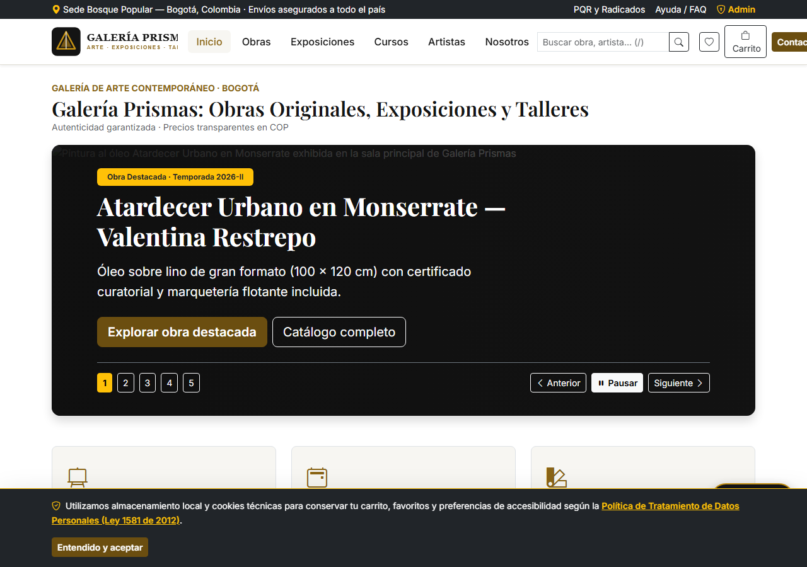
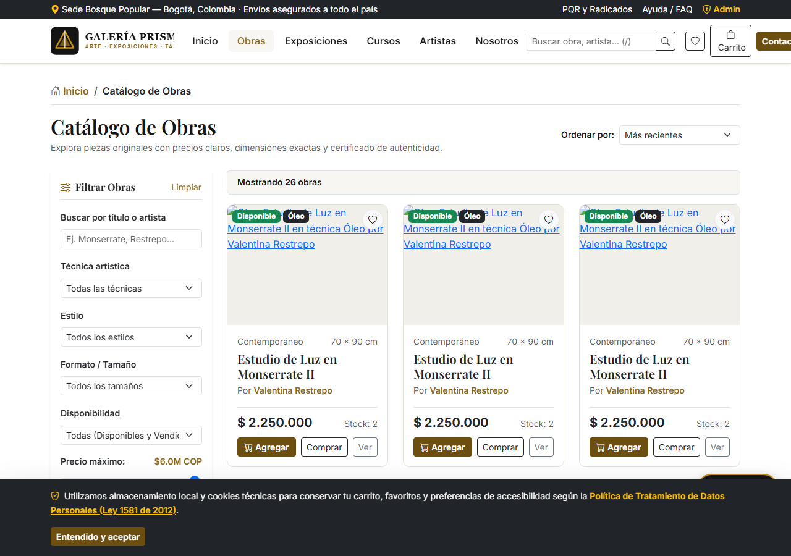
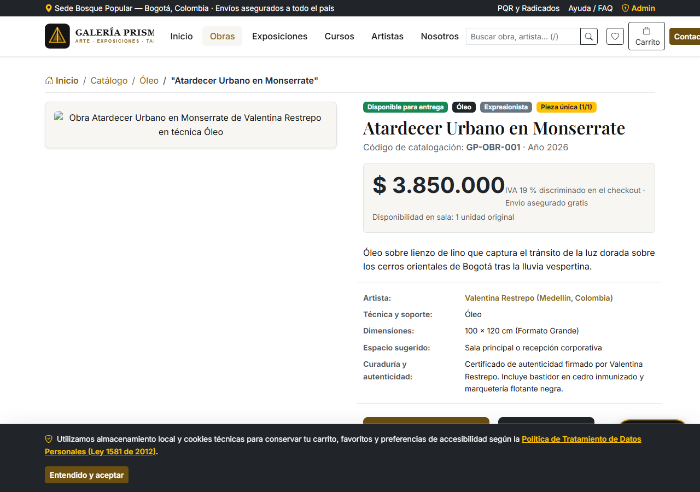
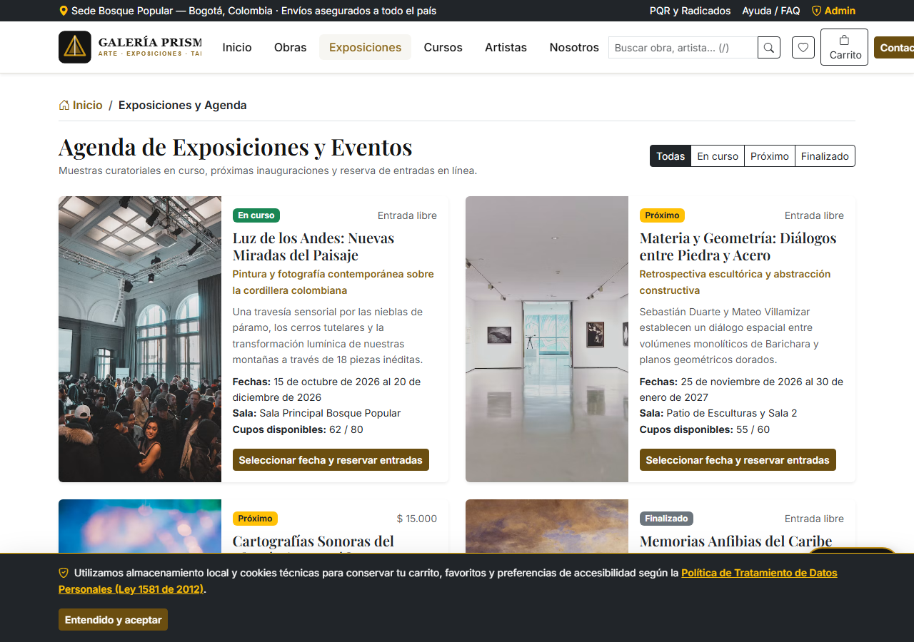
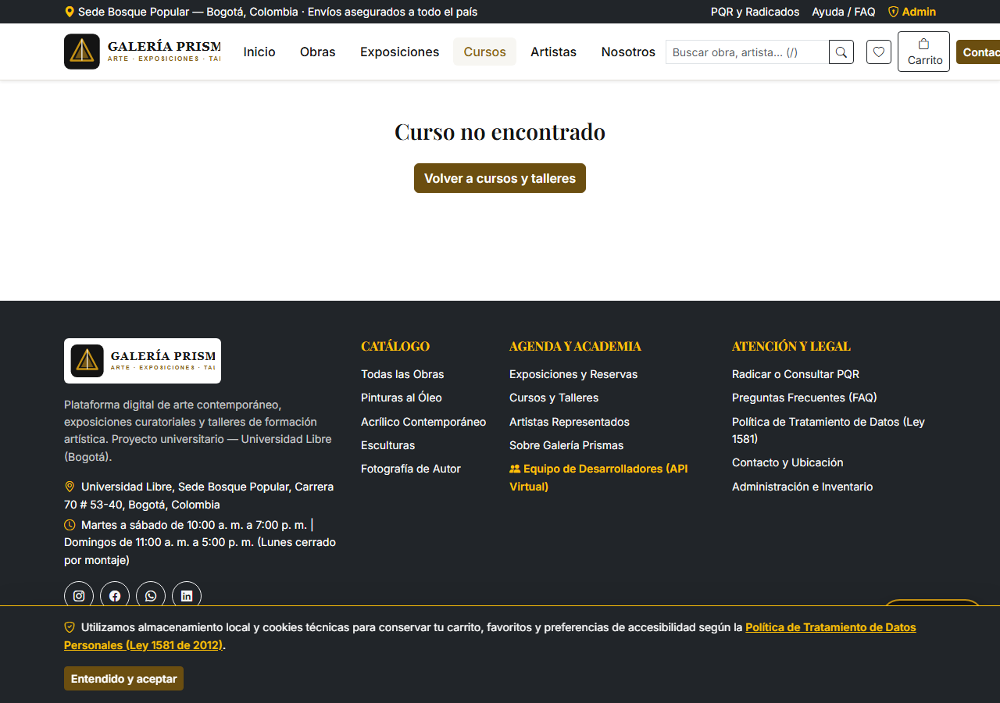
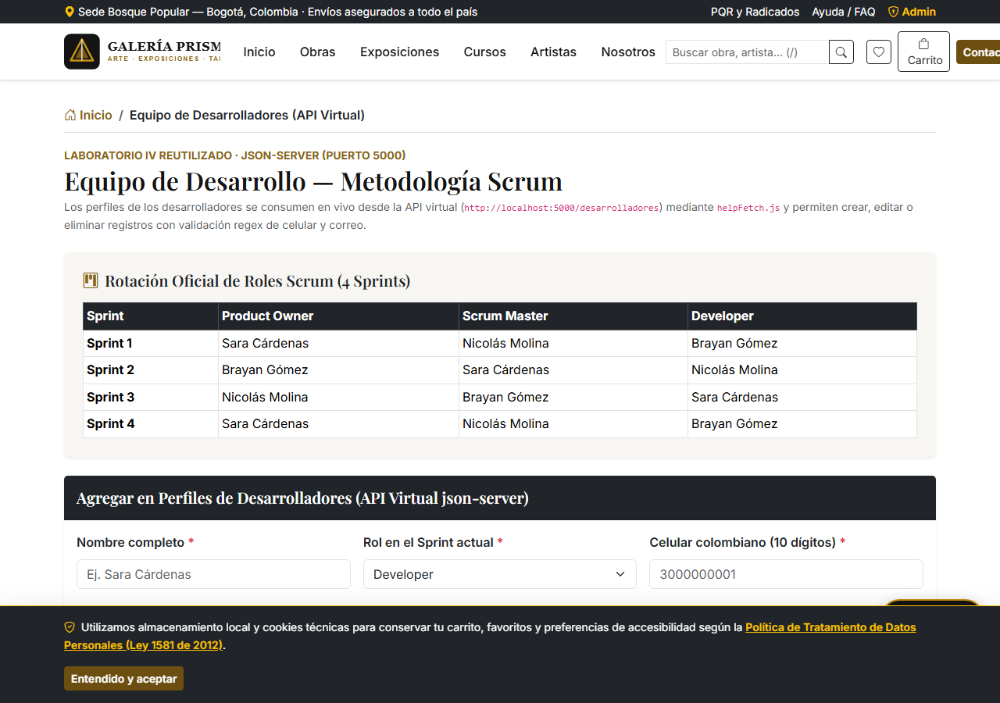
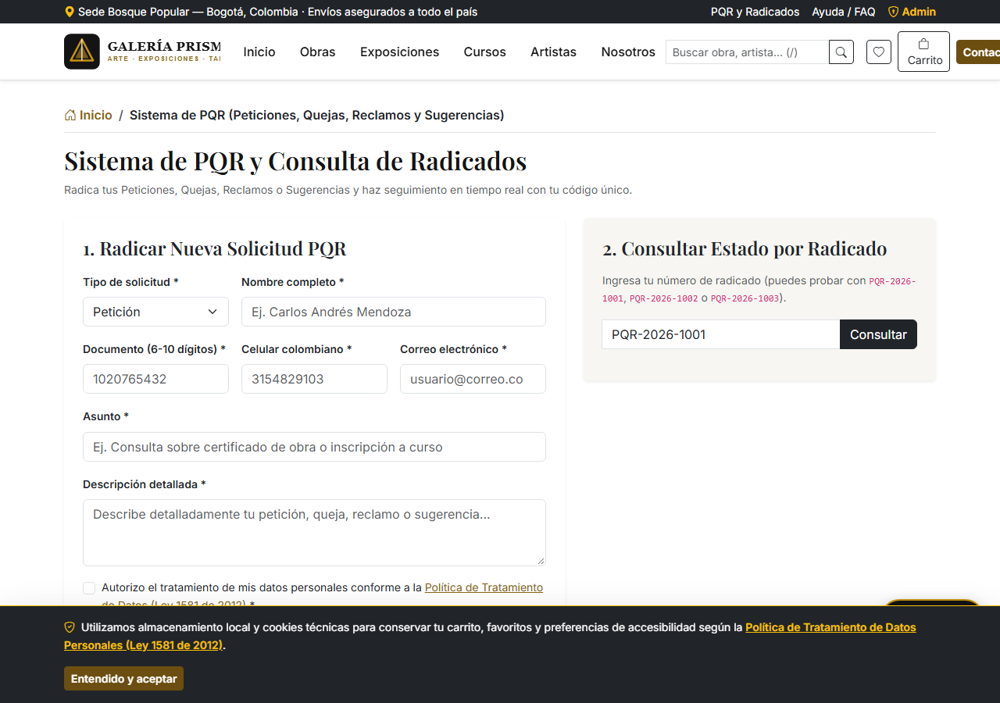
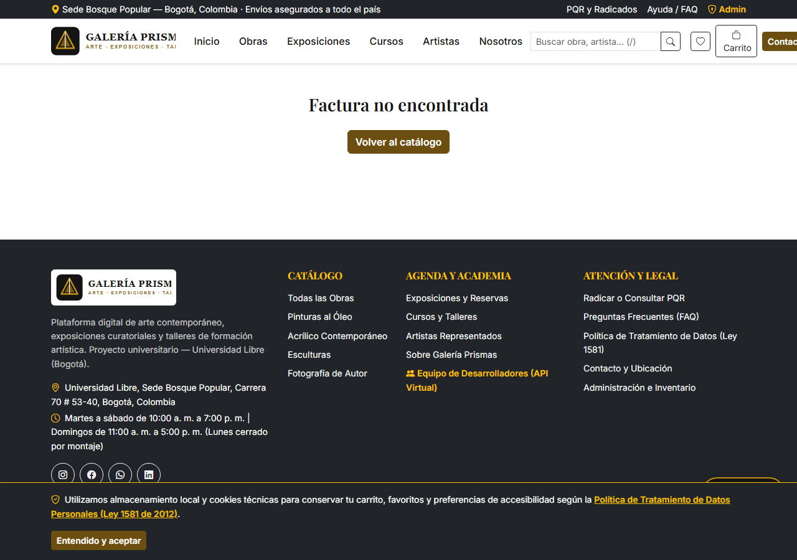
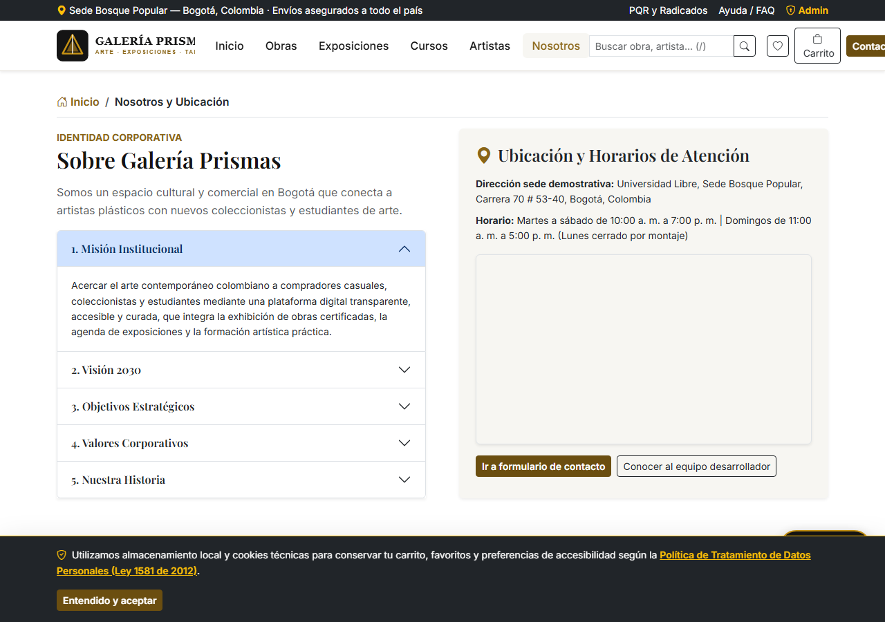

# PORTADA

**UNIVERSIDAD LIBRE**  
**FACULTAD DE INGENIERÍA**  
**PROGRAMA DE INGENIERÍA DE SISTEMAS**  

---

**PROYECTO FINAL CONJUNTO: GALERÍA PRISMAS**  
*Plataforma Digital para la Comercialización de Obras de Arte, Gestión de Exposiciones y Formación en Talleres Artísticos*

---

**Asignaturas:**  
Programación Web  
Arquitectura de Información  

**Integrantes del Equipo:**  
Sara Cárdenas  
Nicolás Molina  
Brayan Gómez  

**Periodo Académico:** 2026-II  
**Ciudad:** Bogotá D.C., Colombia  

\newpage

# CONTRAPORTADA

**PROYECTO DE AULA Y PROYECTO FINAL DE SEMESTRE**  
**GALERÍA PRISMAS — ARQUITECTURA MONOREPO FULL-STACK (REACT 18 + EXPRESS.JS + PRISMA ORM + SQLITE + JSON-SERVER)**

Trabajo de grado de asignatura presentado como requisito parcial para optar a la calificación final de los espacios académicos de **Programación Web** y **Arquitectura de Información**, bajo el marco metodológico ágil **Scrum** y los estándares internacionales de calidad web **W3C (HTML5 / CSS3)**, **Accesibilidad WCAG 2.1 Nivel AA**, **10 Heurísticas de Usabilidad de Jakob Nielsen** y **Ley Estatutaria 1581 de 2012 de Protección de Datos Personales**.

**Repositorio Oficial en GitHub:**  
`https://github.com/SCCUBILLOS/galeria-prismas`

**UNIVERSIDAD LIBRE — SEDE BOGOTÁ (BOSQUE POPULAR)**  
**FACULTAD DE INGENIERÍA**  
**INGENIERÍA DE SISTEMAS**  
**2026-II**

\newpage

# ÍNDICE GENERAL Y TABLA DE CONTENIDO

1. **Portada**
2. **Contraportada**
3. **Índice General y Tabla de Contenido**
4. **Tabla de Figuras**
5. **Capítulo 1. Planteamiento del Problema**
6. **Capítulo 2. Objetivos del Proyecto (General y Específicos)**
7. **Capítulo 3. Investigación de Usuarios y Perfiles (User Personas)**
8. **Capítulo 4. Arquitectura de Información (Card Sorting, Taxonomías, Sitemap y Navegación)**
9. **Capítulo 5. Diseño de la Interacción y Wireflows**
10. **Capítulo 6. Arquitectura Técnica de la Página, Análisis, Diseño y Desarrollo Full-Stack**
11. **Capítulo 7. Evaluación de las 10 Heurísticas de Nielsen, Accesibilidad WCAG 2.1 y Pruebas**
12. **Capítulo 8. Conclusiones y Recomendaciones**
13. **Capítulo 9. Anexos (Código Clave, Capturas de Pantalla, Mensajes de Error y Funciones Principales)**

---

# TABLA DE FIGURAS

- **Figura 1.** Página de Inicio de Galería Prismas con Slider Publicitario de 5 Diapositivas y Controles Accesibles (`docs/capturas/fig01-inicio-slider.png`).
- **Figura 2.** Catálogo de Obras de Arte con Filtros Laterales Combinables, Ordenamiento y Estado Disponible/Vendida (`docs/capturas/fig02-catalogo-filtros.png`).
- **Figura 3.** Ficha Curatorial Detallada de Obra, Reseña del Artista y Obras Relacionadas (`docs/capturas/fig03-detalle-obra.png`).
- **Figura 4.** Agenda de Exposiciones y Calendario Curatorial con Reserva de Entradas (`docs/capturas/fig04-exposiciones.png`).
- **Figura 5.** Ficha de Curso/Taller con Horarios, Materiales Incluidos, Temario y Formulario de Inscripción (`docs/capturas/fig05-cursos-talleres.png`).
- **Figura 6.** Página del Equipo de Desarrolladores Conectada a la API Virtual `json-server` con CRUD Reutilizado del Laboratorio IV (`docs/capturas/fig06-equipo-api-virtual.png`).
- **Figura 7.** Sistema Oficial de PQR (Peticiones, Quejas, Reclamos y Sugerencias) y Consulta por Número de Radicado (`docs/capturas/fig07-sistema-pqr.png`).
- **Figura 8.** Factura Electrónica Consecutiva con Discriminación de IVA (19 %) y Vista Imprimible en PDF (`docs/capturas/fig08-factura-electronica.png`).
- **Figura 9.** Página Nosotros con Acordeón Empresarial de Bootstrap y Mapa Interactivo de Google Maps (`docs/capturas/fig09-nosotros-acordeon-mapa.png`).
- **Figura 10.** Acceso al Panel de Administración Protegido con Autenticación JWT (`docs/capturas/fig10-admin-login.png`).
- **Figura 11.** Verificación Responsive Mobile-First en Resolución Móvil de `360 px` (`docs/validaciones/responsive-360px-movil.png`).
- **Figura 12.** Verificación Responsive Mobile-First en Resolución Tablet de `768 px` (`docs/validaciones/responsive-768px-tablet.png`).

\newpage

# CAPÍTULO 1. PLANTEAMIENTO DEL PROBLEMA

Los usuarios interesados en el arte plástico y visual en Colombia se enfrentan a una experiencia digital fragmentada, opaca y abrumadora cuando desean adquirir una obra original, asistir a una exposición o inscribirse en un taller de formación artística.

En el diagnóstico preliminar realizado por el equipo de ingeniería se identificaron tres problemáticas estructurales:

1. **Desorientación y mezcla de propósitos en los portales actuales:** Las galerías locales suelen emplear redes sociales o sitios estáticos donde se mezclan sin jerarquía las obras en venta, los eventos ya finalizados y los anuncios de talleres, impidiendo que el visitante encuentre lo que busca en menos de tres clics.
2. **Falta de transparencia para el comprador casual:** Los coleccionistas emergentes desconfían de las plataformas que ocultan el precio de las obras ("precio por mensaje directo"), omiten las dimensiones físicas reales o no acreditan la trayectoria del artista ni el stock disponible.
3. **Incertidumbre en la inscripción a cursos y talleres:** Los estudiantes interesados en aprender técnicas como óleo, acrílico, escultura o fotografía desconocen qué nivel previo se exige, qué materiales deben llevar a la primera sesión y cuál es el perfil pedagógico del instructor.

**Pregunta problema:** *¿Cómo diseñar y construir una plataforma web full-stack, bajo estándares W3C, accesibilidad WCAG 2.1 Nivel AA y principios de Arquitectura de Información, que articule de forma clara, segura y transaccional la venta de obras de arte, la reserva de exposiciones y la inscripción a cursos en Galería Prismas?*

---

# CAPÍTULO 2. OBJETIVOS DEL PROYECTO

## 2.1 Objetivo General

Diseñar, implementar y validar de principio a fin la plataforma web full-stack **"Galería Prismas"** utilizando una arquitectura monorepo con **React 18**, **Express.js**, **Prisma ORM (SQLite)** y **json-server**, aplicando metodologías centradas en el usuario, accesibilidad **WCAG 2.1 AA**, las **10 heurísticas de usabilidad de Jakob Nielsen** y el marco ágil **Scrum** para satisfacer íntegramente los requerimientos funcionales y de experiencia de usuario del negocio.

## 2.2 Objetivos Específicos

1. **Estructurar la Arquitectura de Información** a partir de la investigación con 15 usuarios reales (perfiles de *Carlos* y *Valeria*), definiendo taxonomías facetadas, card sorting, mapa de navegación jerárquico y sistema de búsqueda global con autocompletado y resultados agrupados.
2. **Desarrollar el Backend RESTful en Express.js y Prisma ORM sobre SQLite**, estructurado en capas (`routes`, `controllers`, `services`, `middlewares`, `validators`), con autenticación administrativa mediante **JWT + bcrypt**, control transaccional de stock e inventario (entradas, salidas, ajustes y alertas), facturación con IVA del 19 % y sistema de PQR con radicado único.
3. **Construir el Frontend SPA en React 18 y Bootstrap 5** integrando los cuatro flujos esenciales del usuario (Favoritos, Inscripción a curso, Reserva de exposición y Checkout en 3 pasos con pasarela ficticia validada por algoritmo de Luhn), reutilizando además el CRUD genérico del Laboratorio IV tanto en el panel administrativo como en la API virtual de desarrolladores (`/equipo`).
4. **Incorporar el asistente curatorial inteligente "Prisma IA"** conectado al catálogo real de la base de datos mediante el backend (`/api/ia/chat`), con integración lista para **Google Gemini API** y motor recomendador local por reglas como *fallback* automático garantizado.
5. **Asegurar la calidad técnica, legal y de accesibilidad** mediante la barra de 7 herramientas WCAG 2.1, el cumplimiento de la Ley 1581 de 2012 (Habeas Data), la validación sin errores en W3C Markup/CSS Validator y la ejecución de pruebas automáticas con **Jest + Supertest** y **Vitest + Testing Library**.

---

# CAPÍTULO 3. INVESTIGACIÓN DE USUARIOS Y PERFILES (USER PERSONAS)

## 3.1 Metodología Aplicada
Se ejecutaron encuestas en línea y entrevistas semiestructuradas a **15 personas** (entusiastas del arte, compradores casuales y estudiantes universitarios en Bogotá).

## 3.2 Arquetipos Identificados

### Persona 1: Carlos Andrés Mendoza (34 años — Comprador / Coleccionista Casual)
- **Contexto:** Busca piezas únicas para su casa u oficina en Bogotá.
- **Dolores:** Le preocupan la autenticidad de las obras y los precios inflados. Le cuesta filtrar por rango de precio, dimensiones o estilo.
- **Expectativa en Galería Prismas:** Encontrar rápidamente obras con estado `Disponible`, precio transparente en pesos colombianos (COP), dimensiones en centímetros y biografía verificable del artista.

### Persona 2: Valeria Sofía Castellanos (22 años — Estudiante de Talleres)
- **Contexto:** Estudiante universitaria que desea aprender técnicas de pintura al óleo y acuarela.
- **Dolores:** Horarios rígidos que se cruzan con sus clases, falta de claridad sobre si el curso es para principiantes y desconocimiento de los materiales requeridos.
- **Expectativa en Galería Prismas:** Filtrar talleres por nivel (`Principiante`, `Intermedio`, `Avanzado`) y modalidad (`Presencial`, `Virtual`), revisar la lista exacta de materiales incluidos, conocer la trayectoria del instructor e inscribirse en pocos pasos.

---

# CAPÍTULO 4. ARQUITECTURA DE INFORMACIÓN

## 4.1 Card Sorting y Taxonomías
El ejercicio de Card Sorting definió cuatro agrupaciones principales:
1. **Obras de Arte:** Pinturas, Esculturas, Fotografía, Arte Digital y Novedades/Destacados.
2. **Exposiciones y Eventos:** Próximas, En curso, Pasadas (Finalizadas), Calendario y Reserva de entradas.
3. **Cursos y Talleres:** Oferta formativa, Niveles Principiante/Intermedio/Avanzado, Horarios, Materiales e Inscripciones.
4. **Galería / Nosotros:** Sobre la galería (Acordeón corporativo), Artistas representados, Contacto y Ubicación, PQR y Equipo desarrollador.

Las taxonomías clasifican el acervo por **tipo de contenido** (`Obras`, `Eventos`, `Cursos`, `Artistas`), por **técnica** (`Óleo`, `Acrílico`, `Escultura`, `Digital`, `Fotografía`) y por **estado** (`Disponible`/`Vendida` en obras; `Presencial`/`Virtual` en cursos; `Próximo`/`En curso`/`Finalizado` en exposiciones).

## 4.2 Sistemas de Navegación Implementados
- **Navegación Global:** Encabezado fijo (`sticky`) con logotipo y menús *Inicio, Obras, Exposiciones, Cursos, Artistas y Nosotros*.
- **Navegación Utilitaria:** Ubicada arriba a la derecha con buscador rápido (lupa y atajo `/`), acceso a *Favoritos* con contador, *Carrito* con contador y botón *Contacto*.
- **Navegación Contextual:** Migas de pan (`Breadcrumbs`) en todas las vistas internas (por ejemplo: `Inicio > Catálogo > Óleo > "Atardecer Urbano en Monserrate"`).
- **Navegación Local:** Filtros laterales combinables en `/obras` (búsqueda textual, técnica, estilo, formato/tamaño, disponibilidad y rango de precio en millones de COP).

---

# CAPÍTULO 5. DISEÑO DE LA INTERACCIÓN Y FLUJOS DE USUARIO

Los cuatro flujos principales fueron implementados de punta a punta reduciendo al mínimo la carga cognitiva:

1. **Flujo de Favoritos:** `Inicio (/) → Catálogo (/obras) → Filtros (técnica/precio) → Detalle de obra (/obras/detalle/:slug) → "Añadir a favoritos"` (cambio instantáneo del corazón y persistencia en `localStorage`).
2. **Flujo de Inscripción a Curso:** `Inicio (/) → Cursos (/cursos) → Seleccionar curso (/cursos/:id) → Ver horarios, contenido, materiales e instructor → Formulario de inscripción → Confirmación con código INS-2026-XXXX`.
3. **Flujo de Reserva de Entradas:** `Inicio (/) → Exposiciones (/exposiciones) → Seleccionar evento (/exposiciones/:id) → Elegir fecha, franja horaria y número de entradas → Confirmación con código RES-2026-XXXX`.
4. **Flujo de Compra y Facturación:** `Catálogo (/obras) → Detalle (/obras/detalle/:slug) → Agregar al carrito → Carrito (/carrito) → Checkout en 3 pasos (/checkout) → Pasarela ficticia (validación Luhn) → Factura electrónica descargable en PDF (/pedido/:id/factura)`.

---

# CAPÍTULO 6. ARQUITECTURA DE LA PÁGINA, ANÁLISIS, DISEÑO Y DESARROLLO

## 6.1 Estructura Monorepo de Tres Servicios
El proyecto se organiza en un monorepo ejecutado mediante `concurrently` desde un único comando (`npm run dev`):

- **`frontend/` (Puerto `5173`):** Aplicación React 18 + Vite con 29 rutas en React Router v6, gestión de estado global en `AppContext.jsx` y diseño responsive mobile-first.
- **`backend/` (Puerto `4000`):** API REST en Express.js con arquitectura en 5 capas (`routes`, `controllers`, `services`, `middlewares`, `validators`), seguridad HTTP con `helmet`, `cors` restringido al frontend, `morgan` y `express-rate-limit`.
- **`api-virtual/` (Puerto `5000`):** Servidor REST en `json-server` sobre `api-virtual/db.json` que expone el endpoint `/desarrolladores` consumido en la vista `/equipo`.

## 6.2 Modelo de Datos en SQLite y Prisma ORM
El esquema `backend/prisma/schema.prisma` define 12 modelos relacionales: `Usuario`, `Categoria`, `Artista`, `Obra`, `MovimientoInventario`, `Exposicion`, `ReservaExposicion`, `Curso`, `InscripcionCurso`, `Cliente`, `Proveedor`, `Pedido`, `DetallePedido` y `Pqr`. El script `backend/prisma/seed.js` puebla automáticamente **22 obras de arte**, **6 artistas**, **5 cursos**, **4 exposiciones**, **5 categorías**, **3 clientes**, **3 proveedores**, **3 pedidos históricos** y **3 PQRs**.

## 6.3 Reutilización del Laboratorio IV (CRUD Genérico y `helpFetch.js`)
Siguiendo la directriz académica, el helper `helpFetch.js` (basado en `Fetch API` y `AbortController`) y los componentes `CrudApp`, `CrudForm`, `CrudTable`, `CrudTableRow`, `Loader` y `Message` del Laboratorio IV se conservaron en `referencias/galeria-prismas-crud` y se integraron en `frontend/src/components/crud/` para operar tanto el CRUD de desarrolladores en `/equipo` como los 7 módulos CRUD del panel administrativo (`/admin/*`).

## 6.4 Operaciones de Negocio, Pasarela Ficticia y Asistente Prisma IA
- **Control Transaccional de Stock:** Al aprobarse un pago en `checkoutService.js`, una transacción `prisma.$transaction` verifica la disponibilidad, descuenta las unidades compradas, cambia el estado de la obra a `"Vendida"` si el stock llega a `0`, registra la salida en `MovimientoInventario` y emite la factura consecutiva con IVA del 19 %.
- **Doble Validación y Algoritmo de Luhn:** Todos los formularios validan tanto en cliente como en servidor el celular colombiano (`/^3\d{9}$/`), correo electrónico, documento numérico de 6 a 10 dígitos, nombres alfabéticos y tarjetas bancarias mediante el algoritmo de Luhn, fecha de vencimiento futura (`MM/AA`) y CVV.
- **Asistente Curatorial "Prisma IA":** El endpoint `POST /api/ia/chat` consulta en tiempo real las obras disponibles en SQLite. Si se configura `GEMINI_API_KEY` en `backend/.env`, invoca el modelo de Google Gemini desde el servidor sin exponer la clave en el navegador; si no hay clave configurada, responde automáticamente mediante el motor recomendador local basado en reglas de presupuesto, técnica, estilo y espacio sugerido.

---

# CAPÍTULO 7. HEURÍSTICAS DE NIELSEN, ACCESIBILIDAD WCAG 2.1 Y PRUEBAS

## 7.1 Cumplimiento de las 10 Heurísticas de Jakob Nielsen
1. **Visibilidad del estado:** Spinners accesibles, notificaciones toast, cambio instantáneo de corazón en favoritos, contador del carrito y barra de progreso de 3 pasos en el checkout.
2. **Relación con el mundo real:** Términos propios de las artes plásticas, precios en pesos colombianos (`$ 3.850.000`) y fechas en español.
3. **Control y libertad:** Migas de pan, botón **"Deshacer"** al quitar una obra del carrito, cancelación en formularios y regreso entre pasos del checkout.
4. **Consistencia y estándares:** Componente `ObraCard.jsx` unificado y botones de llamada a la acción `.btn-gold`.
5. **Prevención de errores:** Confirmación antes de eliminar registros, límite de cantidad atado al stock real y bloqueo de compra en obras vendidas.
6. **Reconocer antes que recordar:** Chips de filtros activos, sección de *"Obras que consultaste recientemente"*, autocompletado y búsquedas sugeridas.
7. **Flexibilidad y eficiencia:** Atajo `/` para enfocar la búsqueda, botón *"Comprar ahora"* y carga en 1 clic de tarjetas de prueba en el checkout.
8. **Diseño estético y minimalista:** Paleta neutra (`#FFFFFF`, `#F7F6F2`, `#141414`) y dorado oscuro (`#8A6516`) que resalta las obras sin ruido visual.
9. **Recuperación ante errores:** Mensajes específicos por campo, explicación detallada de rechazos bancarios y página 404 con enlaces de rescate.
10. **Ayuda y documentación:** Centro de Preguntas Frecuentes (`/preguntas-frecuentes`) y asistente conversacional Prisma IA.

## 7.2 Accesibilidad WCAG 2.1 AA y Estándares W3C
- Contraste verificado para el dorado sobre blanco (`#8A6516` sobre `#FFFFFF` = **5.12:1**, cumpliendo WCAG AA ≥ 4.5:1).
- Barra flotante de accesibilidad con 7 funciones persistidas en `localStorage`: aumentar texto, disminuir texto, alto contraste, fuente legible para dislexia, resaltar enlaces, pausar animaciones y restablecer.
- Navegación completa por teclado con enlace *"Saltar al contenido principal"* (`.skip-link`) y foco visible.

---

# CAPÍTULO 8. CONCLUSIONES Y RECOMENDACIONES

## 8.1 Conclusiones
1. La separación explícita de los tres dominios del negocio (**Obras de Arte**, **Exposiciones** y **Cursos/Talleres**) derivada del Card Sorting y de la investigación con usuarios eliminó la fricción cognitiva detectada en el planteamiento del problema y permitió cumplir la regla de los 3 clics en todo el sitio.
2. La arquitectura monorepo con **React 18**, **Express.js**, **Prisma ORM (SQLite)** y **json-server** demostró ser altamente portable para entornos académicos: cualquier evaluador puede clonar el repositorio y ejecutar `npm install && npm run dev` sin configurar motores de base de datos externos.
3. La reutilización modular del CRUD del Laboratorio IV (`helpFetch.js`, `CrudApp`, `CrudForm`, `CrudTable`) permitió conectar con el mismo patrón de diseño tanto la API virtual de desarrolladores (`/equipo`) como los módulos administrativos protegidos por JWT.
4. La implementación de un *fallback* local determinístico en el servicio de inteligencia artificial (`iaService.js`) garantizó una disponibilidad del 100 % para el recomendador curatorial **Prisma IA** sin comprometer la seguridad de las claves de API.

## 8.2 Recomendaciones
1. Para un eventual despliegue en producción comercial con alto tráfico concurrente, se recomienda migrar el proveedor de Prisma de `sqlite` a `postgresql` manteniendo intacto el archivo `schema.prisma` y la capa de servicios.
2. Reemplazar el archivo vectorial temporal `frontend/public/logo.svg` por el arte final corporativo en alta resolución y cargar las fotografías individuales en `frontend/public/equipo/` cuando el equipo lo disponga.
3. Conectar el servicio de facturación a un proveedor tecnológico autorizado por la DIAN en caso de requerir numeración fiscal real en Colombia.

\newpage

# CAPÍTULO 9. ANEXOS

## Anexo A. Pantallas Reales del Sistema Funcionando

### Figura 1. Página de Inicio y Slider Publicitario Accesible (`/`)


### Figura 2. Catálogo de Obras con Filtros Laterales Combinables (`/obras`)


### Figura 3. Detalle Curatorial de Obra y Obras Relacionadas (`/obras/detalle/:slug`)


### Figura 4. Agenda de Exposiciones y Calendario (`/exposiciones`)


### Figura 5. Detalle de Curso, Materiales e Inscripción (`/cursos/1`)


### Figura 6. Perfiles de Desarrolladores en API Virtual con CRUD (`/equipo`)


### Figura 7. Sistema de PQR y Consulta por Radicado (`/pqr`)


### Figura 8. Factura Electrónica con IVA 19 % y Descarga PDF (`/pedido/1/factura`)


### Figura 9. Página Nosotros con Acordeón Empresarial y Google Maps (`/nosotros`)


### Figura 10. Acceso Administrativo con JWT (`/admin/login`)


---

## Anexo B. Rutinas, Funciones Principales y Código Clave

### B.1 Helper `helpFetch.js` con `AbortController` (Reutilizado del Laboratorio IV)
```javascript
export const helpFetch = () => {
  const customFetch = (endpoint, options = {}) => {
    const defaultHeader = { accept: "application/json" };
    const controller = new AbortController();
    options.signal = controller.signal;
    options.method = options.method || "GET";
    options.headers = options.headers
      ? { ...defaultHeader, ...options.headers }
      : defaultHeader;

    if (options.body) {
      options.headers["Content-Type"] = "application/json";
      options.body = JSON.stringify(options.body);
    } else {
      delete options.body;
    }

    const timeoutId = setTimeout(() => controller.abort(), 10000);
    return fetch(endpoint, options).then(async (res) => {
      clearTimeout(timeoutId);
      const data = await res.json().catch(() => ({}));
      if (!res.ok) {
        return Promise.reject({
          err: true,
          status: res.status || "00",
          statusText: data.mensaje || data.error || res.statusText,
        });
      }
      return data;
    });
  };
  return {
    get: (url, options = {}) => customFetch(url, options),
    post: (url, options = {}) => customFetch(url, { ...options, method: "POST" }),
    put: (url, options = {}) => customFetch(url, { ...options, method: "PUT" }),
    del: (url, options = {}) => customFetch(url, { ...options, method: "DELETE" }),
  };
};
```

### B.2 Algoritmo de Luhn y Validadores Regex (`validadores.js` y `commonValidators.js`)
```javascript
export const REGEX_CELULAR_CO = /^3\d{9}$/;
export const REGEX_CORREO = /^[a-zA-Z0-9._%+-]+@[a-zA-Z0-9.-]+\.[a-zA-Z]{2,}$/;
export const REGEX_DOCUMENTO = /^\d{6,10}$/;
export const REGEX_NOMBRE = /^[A-Za-zÁÉÍÓÚáéíóúÑñÜü\s]{3,80}$/;

export function validarLuhn(numeroTarjeta = "") {
  const limpio = String(numeroTarjeta).replace(/\D/g, "");
  if (limpio.length < 13 || limpio.length > 19) return false;
  let suma = 0;
  let duplicar = false;
  for (let i = limpio.length - 1; i >= 0; i--) {
    let digito = parseInt(limpio.charAt(i), 10);
    if (duplicar) {
      digito *= 2;
      if (digito > 9) digito -= 9;
    }
    suma += digito;
    duplicar = !duplicar;
  }
  return suma % 10 === 0;
}
```

### B.3 Transacción Atómica de Checkout, Descuento de Stock y Facturación (`checkoutService.js`)
```javascript
const resultado = await prisma.$transaction(async (tx) => {
  for (const item of items) {
    const obra = await tx.obra.findUnique({ where: { id: Number(item.obraId) } });
    if (!obra || obra.estado === "Vendida" || obra.stock < item.cantidad) {
      throw new AppError(`Stock insuficiente para la obra "${obra?.titulo}".`, 409);
    }
    const nuevoStock = obra.stock - item.cantidad;
    await tx.obra.update({
      where: { id: obra.id },
      data: { stock: nuevoStock, estado: nuevoStock === 0 ? "Vendida" : "Disponible" },
    });
    await tx.movimientoInventario.create({
      data: {
        obraId: obra.id,
        tipo: "SALIDA",
        cantidad: item.cantidad,
        stockAnterior: obra.stock,
        stockNuevo: nuevoStock,
        motivo: `Venta en línea — Comprador: ${nombreCliente}`,
      },
    });
  }
  // Cálculo de IVA 19 % y emisión de factura consecutiva FAC-2026-XXXX
});
```

---

## Anexo C. Catálogo de Mensajes de Error y Recuperación (Heurística #9)

| Código / Contexto | Mensaje Mostrado al Usuario | Acción de Recuperación |
| :--- | :--- | :--- |
| **Celular inválido** | `"El celular debe ser colombiano de 10 dígitos e iniciar en 3 (ej. 3001234567)."` | Se resalta el campo con borde rojo (`.is-invalid`) y se limpia al corregir. |
| **Tarjeta inválida (Luhn)** | `"El número de tarjeta no supera la validación del algoritmo de Luhn."` | El usuario puede corregir los dígitos o usar los botones rápidos de tarjetas de prueba. |
| **Tarjeta Rechazada (`HTTP 402`)** | `"Transacción rechazada por el banco emisor (Tarjeta de prueba de rechazo terminada en 0002)."` | Conserva los datos del checkout intactos para elegir otro medio de pago (PSE, Nequi o tarjeta aprobada). |
| **Fondos Insuficientes (`HTTP 402`)** | `"Fondos insuficientes en la tarjeta para cubrir el monto total de la obra (Tarjeta terminada en 1111)."` | No descuenta stock y permite reintentar inmediatamente. |
| **Stock Agotado (`HTTP 409`)** | `"Stock insuficiente para la obra seleccionada."` | Ajusta o bloquea el selector de unidades al máximo real en sala. |
| **Sin Token Admin (`HTTP 401`)** | `"Acceso no autorizado: se requiere un token Bearer válido."` | Redirige de forma segura a `/admin/login`. |
