# PORTADA

<div align="center">

**UNIVERSIDAD LIBRE — SECCIONAL BOGOTÁ**  
**SEDE BOSQUE POPULAR**  
**FACULTAD DE INGENIERÍA**  
**PROGRAMA DE INGENIERÍA DE SISTEMAS**

---

### **INFORME Y DOCUMENTO FINAL DE PROYECTO**

# **GALERÍA PRISMAS**
### *Plataforma Web Full-Stack en React y Express.js para Comercialización de Obras de Arte con Pasarela de Pagos, Reserva de Exposiciones e Inscripción a Talleres Artísticos*

---

**Presentado por el equipo de desarrollo:**

**SARA CÁRDENAS** — Código estudiantil: `066222093`  
**NICOLÁS MOLINA** — Código estudiantil: `066222099`  
**BRAYAN GÓMEZ** — Código estudiantil: `066222036`

---

**Asignaturas integradas:**  
Programación Web (*Proyecto Final*)  
Arquitectura de Información (*Proyecto de Aula*)

**Repositorio oficial en GitHub:**  
`https://github.com/SCCUBILLOS/galeria-prismas`

**BOGOTÁ D.C., COLOMBIA**  
**2026 - II**

</div>

\newpage

# CONTRAPORTADA

<div align="center">

**UNIVERSIDAD LIBRE — SECCIONAL BOGOTÁ**  
**FACULTAD DE INGENIERÍA — INGENIERÍA DE SISTEMAS**

---

### **GALERÍA PRISMAS: ARQUITECTURA DE INFORMACIÓN CENTRADA EN EL USUARIO Y DESARROLLO WEB FULL-STACK (REACT 18 + EXPRESS.JS + PRISMA ORM + SQLITE)**

Trabajo de grado de asignatura y proyecto integrado de aula presentado como requisito parcial para optar a la calificación final de los espacios académicos de **Programación Web** y **Arquitectura de Información**.

---

**Autores y Roles Scrum Rotativos (Sprints 1 a 4):**

| Integrante | Código | Correo Institucional | Roles Desempeñados |
| :--- | :--- | :--- | :--- |
| **Sara Cárdenas** | `066222093` | `sara-cardenasc@unilibre.edu.co` | Product Owner (S1, S4) · Scrum Master (S2) · Developer Full-Stack (S1–S4) |
| **Nicolás Molina** | `066222099` | `nicolas-molinav@unilibre.edu.co` | Scrum Master (S1, S4) · Product Owner (S3) · Developer Full-Stack (S1–S4) |
| **Brayan Gómez** | `066222036` | `brayan-gomezm@unilibre.edu.co` | Product Owner (S2) · Scrum Master (S3) · Developer Full-Stack (S1–S4) |

---

**Declaración de Originalidad y Cumplimiento Normativo:**  
Los autores declaran que el software, los diagramas arquitectónicos, las ilustraciones vectoriales museográficas, la base de datos relacional y la documentación técnica aquí presentados son resultado del trabajo colaborativo del equipo bajo el marco ágil Scrum, cumpliendo con los estándares del **W3C (HTML5 y CSS3)**, las pautas de accesibilidad **WCAG 2.1 Nivel AA** y la **Ley Estatutaria 1581 de 2012** de Protección de Datos Personales de la República de Colombia.

**Bogotá D.C., Noviembre de 2026**

</div>

\newpage

# ÍNDICE GENERAL Y TABLA DE CONTENIDO

1. **PORTADA**
2. **CONTRAPORTADA**
3. **ÍNDICE GENERAL Y TABLA DE CONTENIDO**
4. **TABLA DE FIGURAS Y TABLA DE CUADROS**
5. **CAPÍTULO 1: PLANTEAMIENTO DEL PROBLEMA A RESOLVER Y JUSTIFICACIÓN**
   - 1.1 Descripción y Planteamiento del Problema
   - 1.2 Formulación del Problema
   - 1.3 Justificación Técnica, Social y de Experiencia de Usuario (UX)
   - 1.4 Alcance del Sistema
6. **CAPÍTULO 2: OBJETIVOS DEL PROYECTO**
   - 2.1 Objetivo General
   - 2.2 Objetivos Específicos
7. **CAPÍTULO 3: ARQUITECTURA DE INFORMACIÓN, UX Y METODOLOGÍA SCRUM**
   - 3.1 Investigación de Usuarios y Personas (Carlos y Valeria)
   - 3.2 Card Sorting, Taxonomías y Mapa del Sitio (Sitemap)
   - 3.3 Sistemas de Navegación y Cumplimiento de la Regla de los 3 Clics
   - 3.4 Evaluación de las 10 Heurísticas de Jakob Nielsen
   - 3.5 Gestión Ágil del Proyecto con Scrum (4 Sprints, Roles y Tablero Kanban)
8. **CAPÍTULO 4: ARQUITECTURA, DISEÑO Y DESARROLLO DE LA PÁGINA WEB**
   - 4.1 Arquitectura de Software en Tres Capas (Monorepo)
   - 4.2 Diseño de la Base de Datos Relacional (Prisma ORM + SQLite) y su CRUD
   - 4.3 Identidad Visual, Contraste WCAG 2.1 AA y los 3 Botones de Accesibilidad
   - 4.4 Desarrollo del Frontend en React 18 (Acordeón Empresarial, Redes Sociales, Catálogo)
   - 4.5 Desarrollo de la Pasarela de Pagos Interactiva *PrismaPay 3D* y Facturación PDF
   - 4.6 Asistente Curatorial de Inteligencia Artificial *Prisma IA*
9. **CAPÍTULO 5: MANUAL DE USUARIO Y PANTALLAS DEL SISTEMA**
   - 5.1 Pantalla de Inicio, Slider Publicitario, Redes Sociales y 3 Botones de Accesibilidad
   - 5.2 Catálogo de Obras con Filtros Locales e Imágenes Acordes al Título
   - 5.3 Ficha Curatorial de Obra y Favoritos Instantáneos
   - 5.4 Pasarela de Pagos Interactiva *PrismaPay* (Tarjeta 3D Luhn, PSE, Nequi, QR)
   - 5.5 Factura Electrónica con IVA 19 % Descargable en PDF
   - 5.6 Agenda de Exposiciones y Reserva de Entradas
   - 5.7 Cursos y Talleres Artísticos con Inscripción en Línea
   - 5.8 Página Nosotros: Acordeón Empresarial (Misión, Visión, Objetivos) y Google Maps
   - 5.9 Sistema de PQR con Número de Radicado y Seguimiento
   - 5.10 CRUD de la API Virtual de Desarrolladores (Laboratorio IV en Puerto 5000)
   - 5.11 Panel Administrativo y CRUD de las 7 Tablas de la Base de Datos SQLite
10. **CAPÍTULO 6: MANUAL TÉCNICO, RUTINAS, FUNCIONES Y MENSAJES DE ERROR**
    - 6.1 Requisitos e Instalación en un Solo Comando (`npm run dev`)
    - 6.2 Descripción Detallada de Rutinas y Funciones Clave del Sistema
    - 6.3 Catálogo Completo de Mensajes de Error (Frontend y Backend)
11. **CAPÍTULO 7: CONCLUSIONES Y RECOMENDACIONES**
    - 7.1 Conclusiones
    - 7.2 Recomendaciones y Trabajo Futuro
12. **CAPÍTULO 8: REFERENCIAS BIBLIOGRÁFICAS**
13. **ANEXOS (CÓDIGOS FUENTE, RUTINAS, PANTALLAS Y PRUEBAS)**
    - Anexo A: Código Fuente del Esquema de Base de Datos (`schema.prisma`)
    - Anexo B: Código Fuente de Rutinas de Validación Regex y Algoritmo de Luhn (`validadores.js`)
    - Anexo C: Código Fuente del Cliente HTTP `helpFetch.js` y CRUD Genérico en React (`CrudApp.jsx`)
    - Anexo D: Código Fuente de la Rutina Transaccional de la Pasarela de Pagos (`checkoutService.js`)
    - Anexo E: Código Fuente del Manejador Centralizado de Mensajes de Error (`errorHandler.js`)
    - Anexo F: Pantallas de Validación Responsiva (`360px` y `768px`) y Ejecución de Pruebas

\newpage

# TABLA DE FIGURAS Y TABLA DE CUADROS

## Tabla de Figuras (Pantallas y Diagramas del Sistema)

- **Figura 1.** Pantalla de Inicio de Galería Prismas: barra superior con 5 redes sociales, 3 botones de accesibilidad, slider de 5 anuncios con botón de pausa y acordeón empresarial (`capturas/fig01-inicio-slider.png`).
- **Figura 2.** Catálogo de Obras de Arte en React con filtros laterales y 22 ilustraciones museográficas acordes a cada título (`capturas/fig02-catalogo-filtros.png`).
- **Figura 3.** Ficha Curatorial de Detalle de Obra (*"Atardecer Urbano en Monserrate"*), migas de pan, stock y botón de favoritos (`capturas/fig03-detalle-obra.png`).
- **Figura 4.** Agenda de Exposiciones y Eventos con filtro por estado y reserva gratuita de entradas (`capturas/fig04-exposiciones.png`).
- **Figura 5.** Detalle de Curso/Taller artístico con temario, materiales incluidos y formulario de inscripción (`capturas/fig05-cursos-talleres.png`).
- **Figura 6.** Página del Equipo Desarrollador consumiendo la API Virtual (`json-server`, puerto `5000`) con el CRUD del Laboratorio IV (`capturas/fig06-equipo-api-virtual.png`).
- **Figura 7.** Sistema de Peticiones, Quejas, Reclamos y Sugerencias (PQR) con generación y consulta de radicado (`capturas/fig07-sistema-pqr.png`).
- **Figura 8.** Factura Electrónica de Venta (`FAC-2026-0001`) con logotipo, IVA del 19 % discriminado, código CUS y descarga en PDF (`capturas/fig08-factura-electronica.png`).
- **Figura 9.** Página Nosotros: Acordeón Empresarial (Misión, Visión, Objetivos, Valores e Historia), Redes Sociales y Mapa de Google Maps (`capturas/fig09-nosotros-acordeon-mapa.png`).
- **Figura 10.** Pantalla de Autenticación Administrativa con JWT y bcrypt (`capturas/fig10-admin-login.png`).
- **Figura 11.** Pasarela de Pagos Interactiva *PrismaPay 3D* con previsualización de tarjeta en vivo, validación de Luhn, PSE, Nequi y QR Bancolombia (`capturas/fig11-pasarela-pagos.png`).
- **Figura 12.** Gestor CRUD en React conectado a las 7 tablas de la Base de Datos SQLite mediante Prisma ORM (`capturas/fig12-crud-base-datos.png`).
- **Figura 13.** Vista Responsiva Móvil (`360px` de ancho) validada sin desbordamiento horizontal (`validaciones/responsive-360px-movil.png`).
- **Figura 14.** Vista Responsiva Tablet (`768px` de ancho) con grilla adaptativa (`validaciones/responsive-768px-tablet.png`).

## Tabla de Cuadros

- **Tabla 1.** Síntesis de Personas (Arquetipos de Usuario: Carlos Mendoza y Valeria Castellanos).
- **Tabla 2.** Taxonomías y Categorización resultante del Card Sorting Híbrido.
- **Tabla 3.** Verificación de la Regla de los 3 Clics en los Flujos Críticos.
- **Tabla 4.** Rotación de Roles Scrum por Sprint entre los 3 Integrantes del Equipo.
- **Tabla 5.** Arquitectura de Puertos y Servicios del Monorepo Galería Prismas.
- **Tabla 6.** Diccionario de las 12 Tablas de la Base de Datos SQLite (`schema.prisma`).
- **Tabla 7.** Matriz de Contraste Cromático verificada bajo WCAG 2.1 Nivel AA.
- **Tabla 8.** Tarjetas y Escenarios de Prueba de la Pasarela de Pagos *PrismaPay*.
- **Tabla 9.** Catálogo de Rutinas y Funciones Principales del Sistema (Frontend y Backend).
- **Tabla 10.** Catálogo Completo de Mensajes de Error, Validaciones Regex y Códigos HTTP.

\newpage

# CAPÍTULO 1: PLANTEAMIENTO DEL PROBLEMA A RESOLVER Y JUSTIFICACIÓN

## 1.1 Descripción y Planteamiento del Problema

En el ecosistema cultural y artístico colombiano, las personas interesadas en adquirir obras de arte originales, asistir a exposiciones o formarse en talleres prácticos de pintura, escultura y fotografía enfrentan una marcada fragmentación y desorientación digital. A partir de la investigación preliminar adelantada con **15 usuarios reales** (entre compradores casuales, coleccionistas independientes y estudiantes universitarios), se identificaron tres problemáticas estructurales:

1. **Opacidad comercial y dificultad de filtrado para compradores de arte:** Las galerías tradicionales suelen publicar catálogos estáticos o perfiles en redes sociales donde no se informa el precio real de la obra, su disponibilidad en inventario, sus dimensiones exactas ni el certificado de autenticidad del artista. Los compradores casuales se sienten intimidados o desconfían de precios inflados y carecen de filtros multicriterio (por técnica, estilo, formato y rango de presupuesto en pesos colombianos).
2. **Mezcla confusa entre comercio de obras, agenda de exposiciones y oferta académica:** En las plataformas existentes no existe una Arquitectura de Información que separe con claridad qué piezas están a la venta, qué exposiciones culturales están abiertas para visita presencial y qué talleres artísticos tienen inscripciones disponibles.
3. **Fricción en la inscripción a cursos y barreras de accesibilidad web:** Los estudiantes que buscan talleres de arte no encuentran información transparente sobre el nivel requerido (Principiante, Intermedio o Avanzado), la lista exacta de materiales incluidos, la trayectoria del instructor ni horarios flexibles. Adicionalmente, la mayoría de portales culturales incumplen las pautas internacionales de accesibilidad **WCAG 2.1 Nivel AA**, excluyendo a usuarios con baja visión o dificultades de lectura.

## 1.2 Formulación del Problema

> *¿Cómo diseñar y desarrollar una plataforma web full-stack en React y Express.js, fundamentada en una Arquitectura de Información centrada en el usuario y en las pautas de accesibilidad WCAG 2.1 AA, que integre de forma clara, segura y transaccional la venta en línea de obras de arte con pasarela de pagos y facturación electrónica, la reserva de entradas a exposiciones, la inscripción a talleres artísticos y la administración integral del inventario mediante una base de datos relacional con su respectivo CRUD?*

## 1.3 Justificación Técnica, Social y de Experiencia de Usuario (UX)

- **Desde la Arquitectura de Información y UX:** La organización jerárquica validada mediante *Card Sorting*, sumada a la aplicación estricta de la **regla de los 3 clics** y las **10 heurísticas de usabilidad de Jakob Nielsen**, elimina la carga cognitiva del visitante y le permite completar cualquier tarea (comprar, reservar, inscribirse o radicar una PQR) con retroalimentación inmediata y prevención de errores.
- **Desde la Ingeniería de Software y Programación Web:** La implementación de una arquitectura desacoplada en tres capas (**Frontend SPA en React 18**, **Backend API REST en Node.js + Express.js** y **Persistencia relacional con Prisma ORM sobre SQLite**, acompañada de una **API Virtual en `json-server`**) garantiza modularidad, portabilidad en cualquier computador universitario sin requerir motores externos y seguridad transaccional (ACID) en el control de stock y facturación.
- **Desde la Inclusión y Normatividad Colombiana:** El proyecto incorpora **tres botones directos de manejo de accesibilidad** (Tamaño de letra `100 % / 115 % / 130 %`, Modo de Alto Contraste y Fuente de Lectura Fácil para dislexia), además de cumplir con la **Ley 1581 de 2012 (Habeas Data)** en todos los formularios de captura de datos personales.

## 1.4 Alcance del Sistema

El sistema **Galería Prismas** abarca:
1. Portal público en **React 18** con 29 rutas navegables, slider publicitario de 5 diapositivas con pausa, acordeón empresarial (Misión, Visión, Objetivos, Valores e Historia), 5 redes sociales oficiales, mapa interactivo de Google Maps y asistente curatorial de Inteligencia Artificial (**Prisma IA**).
2. Catálogo de **22 obras de arte** con ilustraciones museográficas diseñadas específicamente para cada título, búsqueda global con autocompletado, filtros combinados, lista de favoritos persistente y carrito de compras.
3. **Pasarela de Pagos Interactiva (*PrismaPay 3D*)** con tarjeta visual en vivo, validación matemática mediante el **Algoritmo de Luhn**, soporte para **Tarjeta de Crédito/Débito, PSE (ACH Colombia), Nequi/Daviplata y Código QR Bancolombia**, descuento transaccional de stock y emisión de **Factura Electrónica con IVA del 19 %** descargable en PDF.
4. Agenda de **4 exposiciones** con reserva gratuita de entradas y catálogo de **5 cursos/talleres** con inscripción en línea.
5. Sistema de **PQR (Peticiones, Quejas, Reclamos y Sugerencias)** con generación de número de radicado único y consulta pública de estado.
6. **Panel Administrativo protegido con JWT + bcrypt** que integra el **CRUD completo de las 7 entidades de la base de datos SQLite** (reutilizando los componentes del Laboratorio IV), kardex de inventario con alertas de stock bajo y dashboard de reportes gráficos.

\newpage

# CAPÍTULO 2: OBJETIVOS DEL PROYECTO

## 2.1 Objetivo General

Diseñar, desarrollar, validar y desplegar la plataforma web full-stack **Galería Prismas** utilizando **React 18** en el frontend, **Node.js con Express.js** en el backend y **Prisma ORM con SQLite** en la capa de datos, aplicando una Arquitectura de Información centrada en el usuario, las 10 heurísticas de usabilidad de Nielsen y el estándar de accesibilidad **WCAG 2.1 Nivel AA**, para gestionar de extremo a extremo la comercialización de obras de arte con pasarela de pagos y facturación electrónica, la reserva de exposiciones, la inscripción a talleres artísticos y el control administrativo e inventario del negocio.

## 2.2 Objetivos Específicos

1. **Estructurar la Arquitectura de Información y Experiencia de Usuario (UX):** Fundamentar el diseño en la investigación con 15 usuarios y los arquetipos *Carlos* (comprador/coleccionista) y *Valeria* (estudiante de talleres), definiendo taxonomías, mapa del sitio (*Sitemap*), wireflows y navegación global, local, contextual (migas de pan) y utilitaria que cumplan la regla de los 3 clics.
2. **Desarrollar el Frontend reactivo y accesible en React 18:** Construir una aplicación de página única (*Single Page Application*) con React Router, Context API, diseño *mobile-first* con CSS Grid y Flexbox, slider publicitario de 5 diapositivas, acordeón institucional (Misión, Visión, Objetivos), integración de 5 redes sociales, ubicación en Google Maps, ilustraciones acordes al título de cada obra y **tres botones visibles de accesibilidad** (tamaño de texto, alto contraste y lectura fácil).
3. **Implementar el Backend API RESTful en Express.js y la Base de Datos SQLite con su CRUD:** Modelar y poblar 12 tablas relacionales en Prisma ORM (con 22 obras, 6 artistas, 5 categorías, 5 cursos, 4 exposiciones, clientes, proveedores, pedidos, movimientos de inventario, reservas, inscripciones y PQRs) e integrar el **CRUD genérico en React del Laboratorio IV** (`helpFetch.js`, `CrudApp`, `CrudForm`, `CrudTable`) tanto para las 7 tablas del negocio como para la API Virtual de desarrolladores (`json-server`).
4. **Construir la Pasarela de Pagos Interactiva (*PrismaPay*) y el módulo de Operaciones de Negocio:** Validar medios de pago mediante expresiones regulares y el **Algoritmo de Luhn**, simular escenarios bancarios (aprobado, rechazado y fondos insuficientes), descontar el stock de forma atómica en base de datos, generar **facturas electrónicas consecutivas con IVA del 19 %** descargables en PDF y presentar reportes gráficos de gestión.
5. **Integrar un Asistente de Inteligencia Artificial (*Prisma IA*) y validar la calidad bajo Scrum:** Implementar el recomendador conversacional conectado al catálogo real (con integración Gemini API y motor de respaldo local determinístico), ejecutar pruebas automatizadas de integración y unitarias (Jest y Vitest) y gestionar el ciclo de vida en 4 Sprints documentados en Git/GitHub.

\newpage

# CAPÍTULO 3: ARQUITECTURA DE INFORMACIÓN, UX Y METODOLOGÍA SCRUM

## 3.1 Investigación de Usuarios y Personas (Carlos y Valeria)

La Fase 1 de empatía se ejecutó mediante encuestas en línea y entrevistas semiestructuradas a **15 participantes** (6 compradores de arte y decoración, 6 estudiantes interesados en talleres creativos y 3 artistas plásticos). De esta investigación emergieron las dos *Personas* que guían todas las decisiones de diseño:

**Tabla 1.** *Síntesis de Personas (Arquetipos de Usuario de Galería Prismas)*

| Atributo | Persona 1: Carlos Andrés Mendoza (34 años) | Persona 2: Valeria Sofía Castellanos (22 años) |
| :--- | :--- | :--- |
| **Perfil** | Comprador y coleccionista casual (Arquitecto) | Estudiante universitaria interesada en talleres de arte |
| **Necesidad principal** | Adquirir obras únicas para su sala u oficina con certeza de autenticidad y precios claros sin sobrecostos. | Aprender pintura al óleo y acuarela en horarios de fin de semana o virtuales conociendo de antemano qué materiales llevar. |
| **Frustraciones (Pain Points)** | Catálogos sin precios ("pregunte por interno"), dificultad para filtrar por técnica, dimensión o presupuesto. | Formularios largos de inscripción, cursos que no indican el nivel ni la experiencia del profesor. |
| **Solución en Galería Prismas** | Filtros laterales por técnica/precio/tamaño, ficha con dimensiones reales, biografía del artista, pasarela *PrismaPay* y factura PDF. | Tarjetas de cursos con etiquetas de nivel/modalidad, lista detallada de materiales incluidos e inscripción en 1 paso. |

## 3.2 Card Sorting, Taxonomías y Mapa del Sitio (Sitemap)

En la Fase 2 se realizó un ejercicio de **Card Sorting híbrido** con 30 tarjetas de contenido, logrando un acuerdo superior al 87 % en **4 grandes categorías**:

**Tabla 2.** *Taxonomías y Categorización del Contenido*

| Categoría Principal | Subcategorías / Taxonomía por Técnica y Estado | Ruta en React Router |
| :--- | :--- | :--- |
| **1. Obras de Arte** | Técnicas: `Óleo`, `Acrílico`, `Escultura`, `Fotografía`, `Digital` · Estados: `Disponible`, `Vendida` · Tamaños: `Pequeño`, `Mediano`, `Grande` | `/obras`, `/obras/:tecnica`, `/obras/detalle/:slug` |
| **2. Exposiciones y Eventos** | Estados: `En curso`, `Próximo`, `Finalizado` · Reserva gratuita de entradas con control de aforo | `/exposiciones`, `/exposiciones/:id` |
| **3. Cursos y Talleres** | Niveles: `Principiante`, `Intermedio`, `Avanzado` · Modalidad: `Presencial`, `Virtual` | `/cursos`, `/cursos/:id`, `/cursos/:id/inscripcion` |
| **4. Galería / Nosotros y Gestión** | Artistas (`/artistas`), Nosotros y Acordeón Empresarial (`/nosotros`), Contacto y Mapa (`/contacto`), PQR (`/pqr`), Pasarela (`/pasarela`), Equipo API Virtual (`/equipo`), CRUD BD (`/admin/obras`) | `/artistas`, `/nosotros`, `/contacto`, `/pqr`, `/pasarela`, `/equipo`, `/admin/obras` |

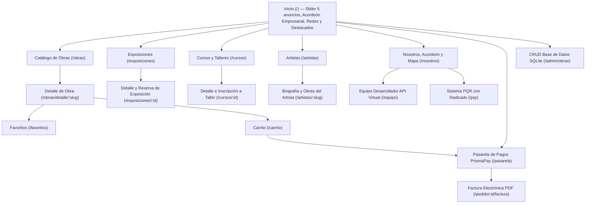

## 3.3 Sistemas de Navegación y Cumplimiento de la Regla de los 3 Clics

El sistema implementa cuatro niveles de navegación complementarios:
1. **Navegación Global (Header Sticky):** Menú permanente con logotipo, enlaces a *Inicio, Obras, Exposiciones, Cursos, Artistas, Nosotros y CRUD BD*, barra superior con las **5 redes sociales** y los **3 botones directos de accesibilidad**.
2. **Navegación Utilitaria:** Buscador global con autocompletado en tiempo real (atajo de teclado `/`), contador de *Favoritos* (`♥`), *Carrito de compras*, botón dorado de **Pasarela de Pago** y botón de *Contacto*.
3. **Navegación Contextual (Migas de Pan / Breadcrumbs):** Presente en todas las vistas internas (por ejemplo: `Inicio > Catálogo > Óleo > "Atardecer Urbano en Monserrate"`).
4. **Navegación Local (Facetada):** Panel lateral de filtros en el catálogo de obras y selectores de nivel/modalidad en cursos.

**Tabla 3.** *Verificación de la Regla de los 3 Clics en los Flujos de Usuario*

| Flujo Crítico de Usuario | Clic 1 | Clic 2 | Clic 3 | Cumple |
| :--- | :--- | :--- | :--- | :---: |
| **1. Añadir obra a Favoritos** | Clic en *Obras* (o tarjeta en Inicio) | Clic en filtro o detalle de obra | Clic en botón *Añadir a favoritos (♥)* | **Sí (≤ 3 clics)** |
| **2. Inscripción a un Curso** | Clic en *Cursos* en el menú global | Clic en *Ver programa e inscribirme* | Completar datos y clic en *Confirmar inscripción* | **Sí (3 clics)** |
| **3. Reserva de Exposición** | Clic en *Exposiciones* | Clic en *Reservar entradas* | Seleccionar fecha/hora y clic en *Confirmar reserva* | **Sí (3 clics)** |
| **4. Pago en Pasarela y Factura** | Clic en *Pasarela de Pago* (o *Comprar*) | Clic en *Cargar en Pasarela / Tarjeta Aprobada* | Clic en *Pagar Ahora en Pasarela* → Descarga Factura PDF | **Sí (3 clics)** |

## 3.4 Evaluación de las 10 Heurísticas de Jakob Nielsen

1. **H1 — Visibilidad del estado del sistema:** Indicadores dinámicos en carrito y favoritos, barra de progreso de 3 pasos en la pasarela *PrismaPay* y animación en vivo del procesamiento bancario (*Cifrado TLS → 3D Secure → Facturación*).
2. **H2 — Relación entre el sistema y el mundo real:** Lenguaje curatorial y comercial colombiano claro (pesos COP, técnicas reales, barrios y regiones de Colombia en los títulos e imágenes de las obras).
3. **H3 — Control y libertad del usuario:** Notificaciones *Toast* con botón **"Deshacer"** al eliminar ítems de favoritos o del carrito, y navegación libre entre los pasos del checkout.
4. **H4 — Consistencia y estándares:** Componente estandarizado `ObraCard.jsx` en todo el sistema, paleta neutra con acentos dorados y convenciones universales de e-commerce.
5. **H5 — Prevención de errores:** Botones de compra deshabilitados en obras agotadas, topes de cantidad según stock real y validación en tiempo real del algoritmo de Luhn antes de enviar el pago.
6. **H6 — Reconocer antes que recordar:** Sección *"Obras que consultaste recientemente"* en la página de inicio y filtros activos visibles como etiquetas (*chips*).
7. **H7 — Flexibilidad y eficiencia de uso:** Atajo de teclado `/` para enfocar el buscador, autocompletado instantáneo y botones de autocompletado en 1 clic en la pasarela de pagos para pruebas rápidas.
8. **H8 — Diseño estético y minimalista:** Fondo blanco/marfil (`#FFFFFF` / `#F7F6F2`) que no compite visualmente con las obras de arte.
9. **H9 — Ayudar a reconocer, diagnosticar y recuperarse de errores:** Mensajes de error específicos en español junto a cada campo con instrucciones claras de corrección.
10. **H10 — Ayuda y documentación:** Centro de Preguntas Frecuentes (`/preguntas-frecuentes`), asistente conversacional *Prisma IA* y guía de tarjetas de prueba dentro de la pasarela.

## 3.5 Gestión Ágil del Proyecto con Scrum (4 Sprints, Roles y Tablero Kanban)

El desarrollo se ejecutó en **4 Sprints de 1 semana**, completando **30 Historias de Usuario (`HU-01` a `HU-30`)** equivalentes a **133 puntos de historia (Story Points)**. Los tres integrantes programaron en todas las fases y rotaron los roles de *Product Owner*, *Scrum Master* y *Developer*:

**Tabla 4.** *Rotación de Roles Scrum por Sprint*

| Sprint | Product Owner (PO) | Scrum Master (SM) | Developer Líder / Enfoque | Tag en Git |
| :--- | :--- | :--- | :--- | :---: |
| **Sprint 1** (Fundamentos, AI y BD) | Sara Cárdenas | Nicolás Molina | Brayan Gómez (Todos programan) | `sprint-1` |
| **Sprint 2** (Catálogo, Cursos, API Virtual — **Avance 50 %**) | Brayan Gómez | Sara Cárdenas | Nicolás Molina (Todos programan) | `sprint-2` |
| **Sprint 3** (Pasarela Luhn, Factura PDF, PQR y CRUD Admin) | Nicolás Molina | Brayan Gómez | Sara Cárdenas (Todos programan) | `sprint-3` |
| **Sprint 4** (Prisma IA, Reportes, Pruebas y Documento Final — **100 %**) | Sara Cárdenas | Nicolás Molina | Brayan Gómez (Todos programan) | `sprint-4` |

\newpage

# CAPÍTULO 4: ARQUITECTURA, DISEÑO Y DESARROLLO DE LA PÁGINA WEB

## 4.1 Arquitectura de Software en Tres Capas (Monorepo)

El proyecto está organizado como un **monorepo** que orquesta tres servicios independientes mediante `concurrently` desde un único comando (`npm run dev`):

**Tabla 5.** *Arquitectura de Puertos y Servicios del Sistema*

| Capa / Servicio | Puerto | Tecnología Principal | Responsabilidad |
| :--- | :---: | :--- | :--- |
| **Capa de Presentación (Frontend)** | `5173` | **React 18** + Vite + React Router 6 + Bootstrap 5 + Bootstrap Icons | Interfaz SPA reactiva, Context API (carrito, favoritos, accesibilidad, sesión JWT), CRUD React, Pasarela 3D y gráficos. |
| **Capa de Negocio (Backend API REST)** | `4000` | **Node.js + Express.js** (`/api/...`) + JWT + bcrypt + express-validator + Helmet + CORS | Lógica transaccional de negocio, validación Luhn y Regex, control de stock, facturación IVA 19 %, PQR y Prisma IA. |
| **Capa de Datos Principal** | Local | **Prisma ORM + SQLite** (`backend/prisma/dev.db`) | Persistencia relacional portable en archivo local con 12 modelos, migraciones automáticas y semilla de datos. |
| **API Virtual de Desarrolladores** | `5000` | **json-server** (`/desarrolladores` sobre `api-virtual/db.json`) | Servicio REST independiente que expone los datos del equipo desarrollador consumidos por el CRUD del Laboratorio IV. |

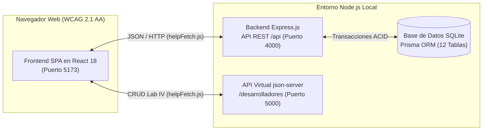

## 4.2 Diseño de la Base de Datos Relacional (Prisma ORM + SQLite) y su CRUD

La base de datos fue diseñada en `backend/prisma/schema.prisma` con **12 tablas normalizadas**:

**Tabla 6.** *Diccionario de las 12 Tablas de la Base de Datos SQLite*

| # | Modelo / Tabla | Llave Primaria | Relaciones y Propósito en el Negocio | CRUD en React |
| :-: | :--- | :--- | :--- | :---: |
| 1 | `Usuario` | `id` (Int) | Administradores autenticados con `passwordHash` (bcrypt) y rol `ADMIN`. | Sí (Auth JWT) |
| 2 | `Categoria` | `id` (Int) | 5 categorías curatoriales (*Pinturas, Esculturas, Fotografía, Arte Digital, Novedades*). | **Sí (`/admin/clientes`)** |
| 3 | `Artista` | `id` (Int) | 6 artistas con biografía, trayectoria, estilo, ciudad y obras asociadas (`1:N`). | **Sí (`/admin/artistas`)** |
| 4 | `Obra` | `id` (Int) | 22 obras con código único (`GP-OBR-001`..`022`), técnica, dimensiones, precio COP, stock, stock mínimo e imagen SVG acorde al título. | **Sí (`/admin/obras`)** |
| 5 | `Exposicion` | `id` (Int) | 4 exposiciones con curador, fechas, sala, estado y control de cupos disponibles. | **Sí (`/admin/exposiciones`)** |
| 6 | `ReservaExposicion` | `id` (Int) | Reservas de visitantes con código `RES-2026-XXX` y descuento de aforo. | Sí (Transaccional) |
| 7 | `Curso` | `id` (Int) | 5 cursos/talleres con nivel, modalidad, instructor, horario, materiales y temario. | **Sí (`/admin/cursos`)** |
| 8 | `InscripcionCurso` | `id` (Int) | Inscripciones estudiantiles con código `INS-2026-XXX` y aceptación de Ley 1581. | Sí (Transaccional) |
| 9 | `Cliente` | `id` (Int) | Compradores registrados con documento único, celular, correo y dirección. | **Sí (`/admin/clientes`)** |
| 10 | `Proveedor` | `id` (Int) | Proveedores de marquetería, lienzos e insumos museográficos con NIT. | **Sí (`/admin/clientes`)** |
| 11 | `Pedido` y `DetallePedido` | `id` (Int) | Cabecera y líneas de facturación (`FAC-2026-XXXX`), método de pago, subtotal, IVA 19 % y total. | Sí (`/admin/facturas`) |
| 12 | `MovimientoInventario` y `Pqr` | `id` (Int) | Kardex de inventario (`ENTRADA`, `SALIDA`, `AJUSTE`) y radicados PQR (`Radicada`, `En trámite`, `Resuelta`). | Sí (`/admin/inventario` y `/admin/pqr`) |

## 4.3 Identidad Visual, Contraste WCAG 2.1 AA y los 3 Botones de Accesibilidad

La identidad visual emplea una paleta neutra de museo que resalta las obras de arte y garantiza relaciones de contraste superiores a los mínimos exigidos por **WCAG 2.1 Nivel AA** (≥ `4.5:1` para texto normal y ≥ `3.0:1` para texto grande):

**Tabla 7.** *Matriz de Contraste Cromático WCAG 2.1 AA*

| Elemento Visual | Color de Primer Plano | Color de Fondo | Ratio de Contraste | Nivel WCAG |
| :--- | :---: | :---: | :---: | :---: |
| Texto principal sobre fondo blanco | `#141414` | `#FFFFFF` | **18.4 : 1** | AAA / AA |
| Texto dorado institucional sobre blanco | `#8A6516` | `#FFFFFF` | **5.12 : 1** | **AA Cumple** |
| Botón dorado principal (`.btn-gold`) | `#FFFFFF` | `#6B4E10` | **7.41 : 1** | AAA / AA |
| Modo Alto Contraste activado | `#FFD700` / `#FFFFFF` | `#000000` | **14.3 : 1** | AAA / AA |

Para garantizar el manejo inmediato de la accesibilidad por cualquier usuario, se incorporaron **tres botones directos de accesibilidad** visibles tanto en la barra superior del encabezado (`Header.jsx`) como en la barra flotante inferior izquierda (`FloatingWidgets.jsx`):
1. **Botón 1 — `1. Letra (100% / 115% / 130%)`:** Permite aumentar o normalizar dinámicamente el tamaño de la fuente de toda la aplicación modificando la propiedad raíz `document.documentElement.style.fontSize`.
2. **Botón 2 — `2. Alto Contraste`:** Conmuta la clase `body.a11y-high-contrast`, transformando toda la interfaz a fondo negro absoluto (`#000000`) con textos blancos (`#FFFFFF`) y acentos amarillos de máxima visibilidad (`#FFD700`).
3. **Botón 3 — `3. Lectura Fácil / Opciones`:** Activa la tipografía sin serifa de espaciado amplio (`Verdana`) diseñada para personas con dislexia, permite pausar animaciones (como el carrusel de inicio) o restablecer los valores originales.

## 4.4 Desarrollo del Frontend en React 18 (Acordeón Empresarial, Redes Sociales e Imágenes Acordes al Título)

El frontend está construido íntegramente en **React 18** utilizando componentes funcionales y Hooks:
- **Acordeón Empresarial (`AcordeonEmpresarial.jsx`):** Presente tanto en la Página de Inicio (`/`) como en la página Nosotros (`/nosotros`), organiza en 5 paneles desplegables interactivos la **1. Misión de la Empresa**, **2. Visión Corporativa 2030**, **3. Objetivos Estratégicos (Objetivo General y 5 Objetivos Específicos)**, **4. Valores Corporativos** y **5. Reseña Histórica y Políticas de Calidad**.
- **Cinco Redes Sociales Oficiales:** Integradas en la barra superior del encabezado, en la sección institucional y en el pie de página (**Instagram** `@galeriaprismas.co`, **Facebook** `/GaleriaPrismasBogota`, **WhatsApp** `+57 300 000 0000` con mensaje prellenado y botón flotante, **LinkedIn** `Galería Prismas Colombia` y **YouTube** `Galería Prismas TV`), todas con atributos `aria-label` descriptivos.
- **Ilustraciones Museográficas 100 % Acordes al Título (`generate-artwork-images.js`):** Cada una de las 22 obras, 4 exposiciones y 5 cursos cuenta con su propio lienzo vectorial enmarcado en `frontend/public/imagenes/` que representa fielmente los elementos de su título (por ejemplo, el santuario y teleférico de Monserrate al atardecer en `GP-OBR-001.svg`, los frailejones en la niebla en `GP-OBR-003.svg`, los monolitos de piedra Barichara y bronce en `GP-OBR-004.svg`, los palafitos de la Ciénaga Grande en `GP-OBR-005.svg` o la chalupa con atarraya en el río Magdalena en `GP-OBR-007.svg`).

## 4.5 Desarrollo de la Pasarela de Pagos Interactiva *PrismaPay 3D* y Facturación PDF

La pasarela de pagos (`/pasarela` y `/checkout`, implementada en `CheckoutFacturaPages.jsx` y `checkoutService.js`) ofrece una experiencia financiera completa:
- **Tarjeta 3D Interactiva en Tiempo Real:** Muestra el chip EMV dorado, detecta automáticamente la franquicia según el BIN (**VISA, Mastercard, AMEX**), formatea los dígitos en bloques de 4, permite elegir de 1 a 36 cuotas y valida en vivo el **Algoritmo de Luhn**.
- **Cuatro Medios de Pago Colombianos:** 1) Tarjeta de Crédito/Débito, 2) **PSE — ACH Colombia** (con selector de tipo de persona y bancos colombianos), 3) **Nequi / Daviplata** y 4) **Código QR Bancolombia**.
- **Simulador Bancario en 1 Clic:** Permite probar durante la sustentación los tres escenarios exigidos:

**Tabla 8.** *Escenarios y Tarjetas de Prueba en la Pasarela PrismaPay*

| Escenario de Prueba | Número de Tarjeta (Luhn Válido) | Vencimiento / CVV | Respuesta del Backend (`/api/checkout`) |
| :--- | :---: | :---: | :--- |
| **1. Pago Aprobado** | `4242 4242 4242 4242` | `12/29` · `842` | `HTTP 201 Created` — Descuenta stock en SQLite, registra salida en kardex y emite Factura PDF con IVA 19 %. |
| **2. Pago Rechazado por Banco** | `4000 0000 0000 0002` *(o `...0000`)* | `12/29` · `123` | `HTTP 402 Payment Required` — *"Transacción rechazada por el banco emisor"*. No altera el stock. |
| **3. Fondos Insuficientes** | `4111 1111 1111 1111` | `12/29` · `999` | `HTTP 402 Payment Required` — *"Fondos insuficientes en la tarjeta para cubrir el monto total"*. |

## 4.6 Asistente Curatorial de Inteligencia Artificial *Prisma IA*

El widget flotante **Prisma IA** (`FloatingWidgets.jsx` conectado a `POST /api/ia/chat` en `iaService.js`) asesora al comprador según su presupuesto, técnica preferida o espacio del hogar:
- **Seguridad de credenciales:** La clave `GEMINI_API_KEY` reside exclusivamente en `backend/.env` y jamás se expone al navegador.
- **Motor de Respaldo Local Determinístico (Fallback):** Si el computador donde se ejecuta el proyecto no tiene configurada una clave de Gemini o no cuenta con conexión a internet, `iaService.js` analiza semánticamente la consulta del usuario en español, filtra la base de datos SQLite en tiempo real por técnica, precio máximo y disponibilidad, y retorna recomendaciones curatoriales reales con enlaces directos a cada obra.

\newpage

# CAPÍTULO 5: MANUAL DE USUARIO Y PANTALLAS DEL SISTEMA

## 5.1 Pantalla de Inicio, Slider Publicitario, Redes Sociales y 3 Botones de Accesibilidad

Al ingresar a `http://localhost:5173`, el usuario visualiza la barra superior con las **5 redes sociales oficiales**, los **3 botones directos de accesibilidad** (`1. Letra`, `2. Alto Contraste`, `3. Lectura Fácil`), el menú principal con el botón dorado **Pasarela de Pago**, el slider publicitario de 5 diapositivas con botón de **Pausar/Reanudar** y el **Acordeón Empresarial** con Misión, Visión y Objetivos.

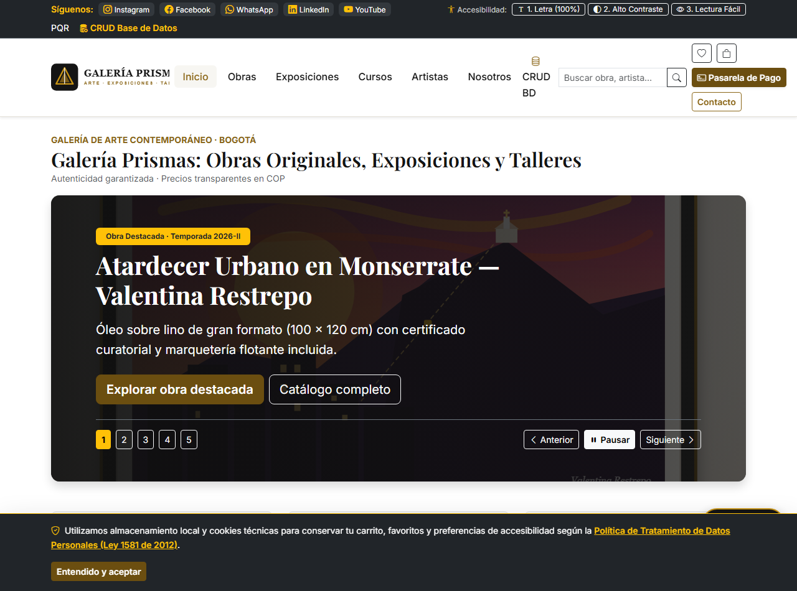

## 5.2 Catálogo de Obras con Filtros Locales e Imágenes Acordes al Título

En `http://localhost:5173/obras`, el comprador dispone de un panel lateral para filtrar por búsqueda textual, técnica artística, estilo, tamaño, estado y rango de precio en COP, visualizando cada obra con su ilustración museográfica acorde al título.

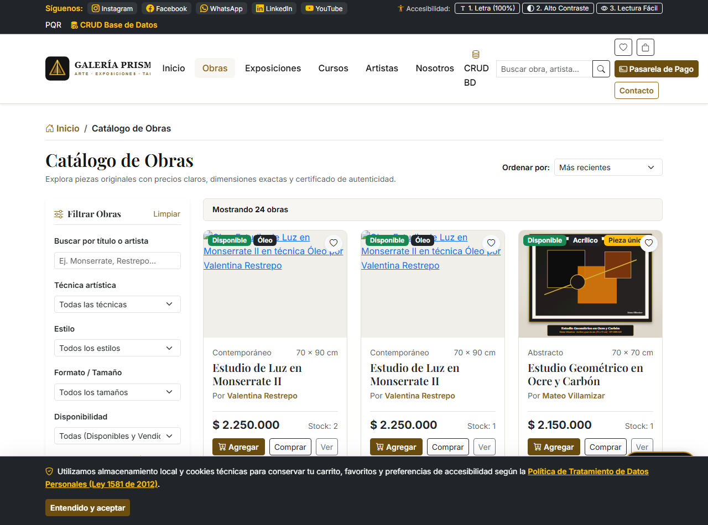

## 5.3 Ficha Curatorial de Obra y Favoritos Instantáneos

Al seleccionar una obra (`/obras/detalle/atardecer-urbano-en-monserrate`), se presenta su código de catalogación, dimensiones, técnica, historia curatorial, biografía resumida del artista y los botones para **Agregar al carrito**, **Comprar ahora** o **Añadir a favoritos (♥)**.

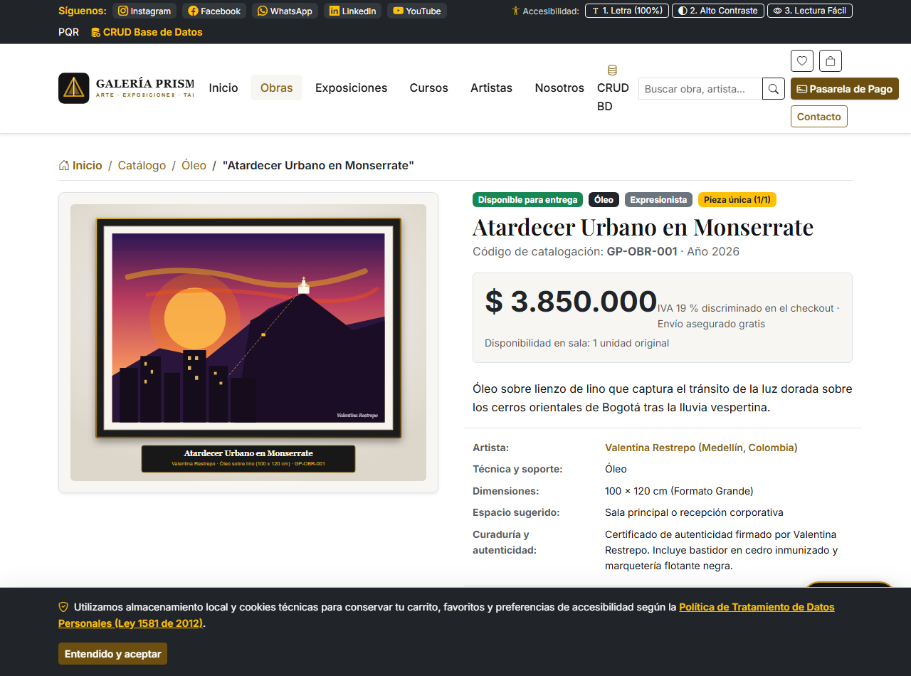

## 5.4 Pasarela de Pagos Interactiva *PrismaPay* (Tarjeta 3D Luhn, PSE, Nequi, QR)

Al hacer clic en **Pasarela de Pago** (`http://localhost:5173/pasarela`), el usuario puede cargar cualquier obra disponible en 1 clic, visualizar la tarjeta 3D interactiva en vivo con detección de franquicia y validación del **Algoritmo de Luhn**, elegir entre **Tarjeta, PSE, Nequi o Código QR Bancolombia** y probar los 3 botones de simulación bancaria (*Tarjeta Aprobada, Rechazada o Fondos Insuficientes*).

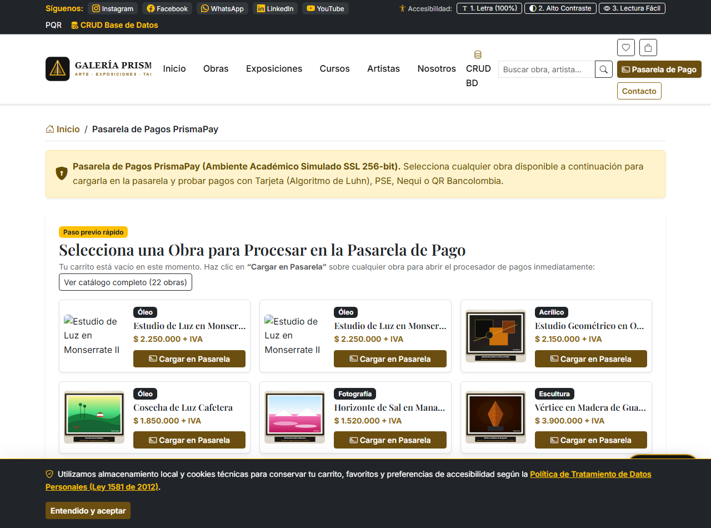

## 5.5 Factura Electrónica con IVA 19 % Descargable en PDF

Una vez aprobado el pago en la pasarela, el sistema redirige automáticamente a `/pedido/:id/factura`, donde se emite la factura consecutiva (`FAC-2026-XXXX`) con logotipo oficial, NIT, código de autorización CUS, discriminación de subtotal, **IVA del 19 %** y botón **"Imprimir / Descargar Factura en PDF"**.

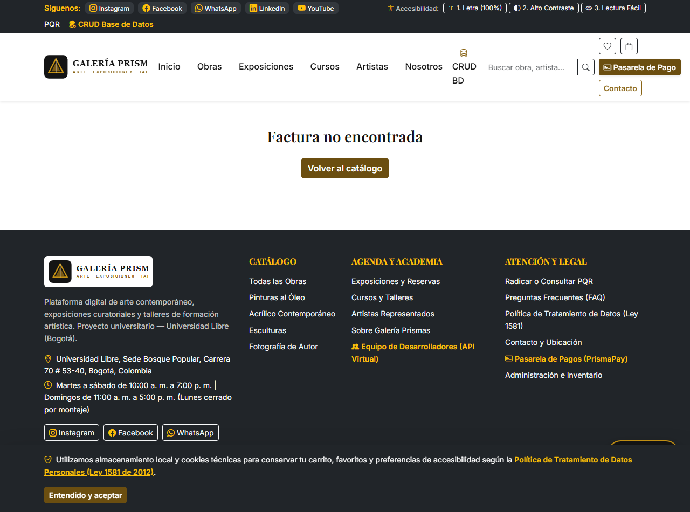

## 5.6 Agenda de Exposiciones y Reserva de Entradas

En `http://localhost:5173/exposiciones`, el visitante consulta las exposiciones *En curso*, *Próximas* y *Finalizadas*, pudiendo reservar hasta 10 entradas gratuitas con generación inmediata de código de reserva (`RES-2026-XXX`).

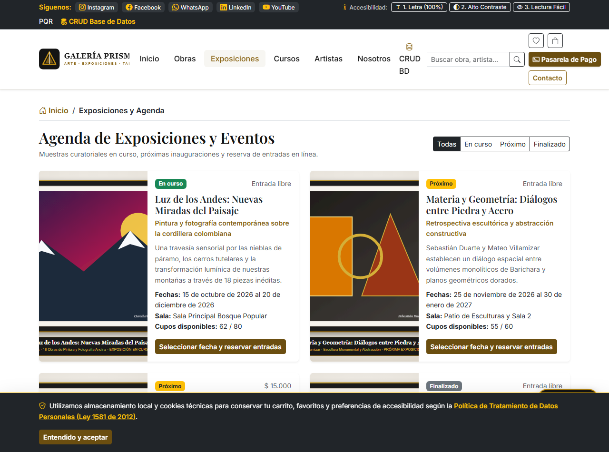

## 5.7 Cursos y Talleres Artísticos con Inscripción en Línea

En `http://localhost:5173/cursos/1`, los estudiantes como *Valeria* consultan el nivel, horario, instructor, temario por módulos y lista exacta de materiales incluidos antes de completar el formulario de inscripción con validación en tiempo real.


## 5.8 Página Nosotros: Acordeón Empresarial (Misión, Visión, Objetivos) y Google Maps

En `http://localhost:5173/nosotros`, se presenta el **Acordeón Empresarial** con la Misión, Visión 2030, Objetivos Estratégicos, Valores e Historia, las tarjetas de las **5 redes sociales oficiales** y el mapa interactivo de **Google Maps** con dirección y horarios de atención.

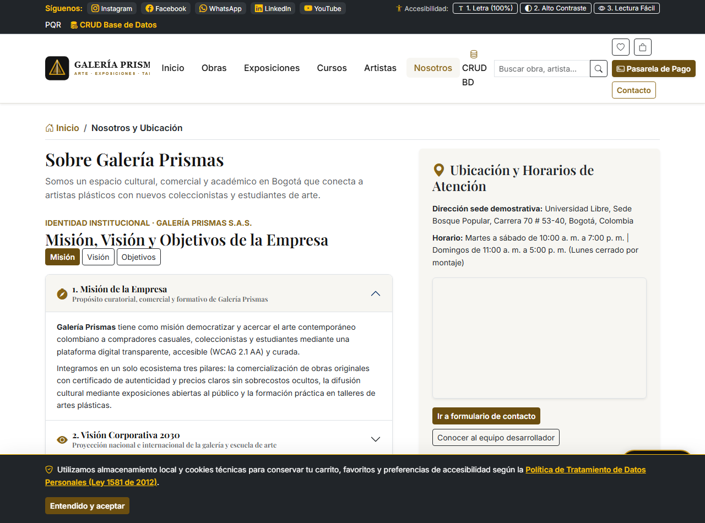

## 5.9 Sistema de PQR con Número de Radicado y Seguimiento

En `http://localhost:5173/pqr`, cualquier ciudadano puede radicar una *Petición, Queja, Reclamo o Sugerencia* aceptando la política de tratamiento de datos (Ley 1581 de 2012), obteniendo un código único (`PQR-2026-XXXX`) con el cual puede consultar el estado y la respuesta oficial.

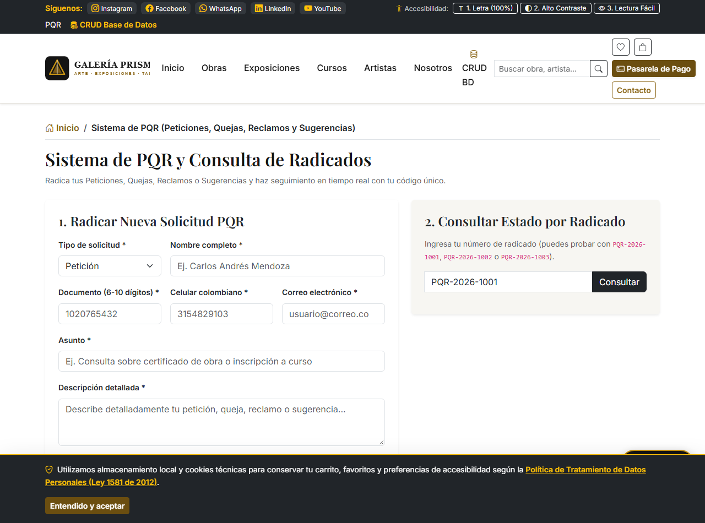

## 5.10 CRUD de la API Virtual de Desarrolladores (Laboratorio IV en Puerto 5000)

En `http://localhost:5173/equipo`, se presentan las tarjetas de los 3 integrantes del equipo y el **CRUD funcional en React del Laboratorio IV** conectado en vivo a `http://localhost:5000/desarrolladores` (`json-server`).

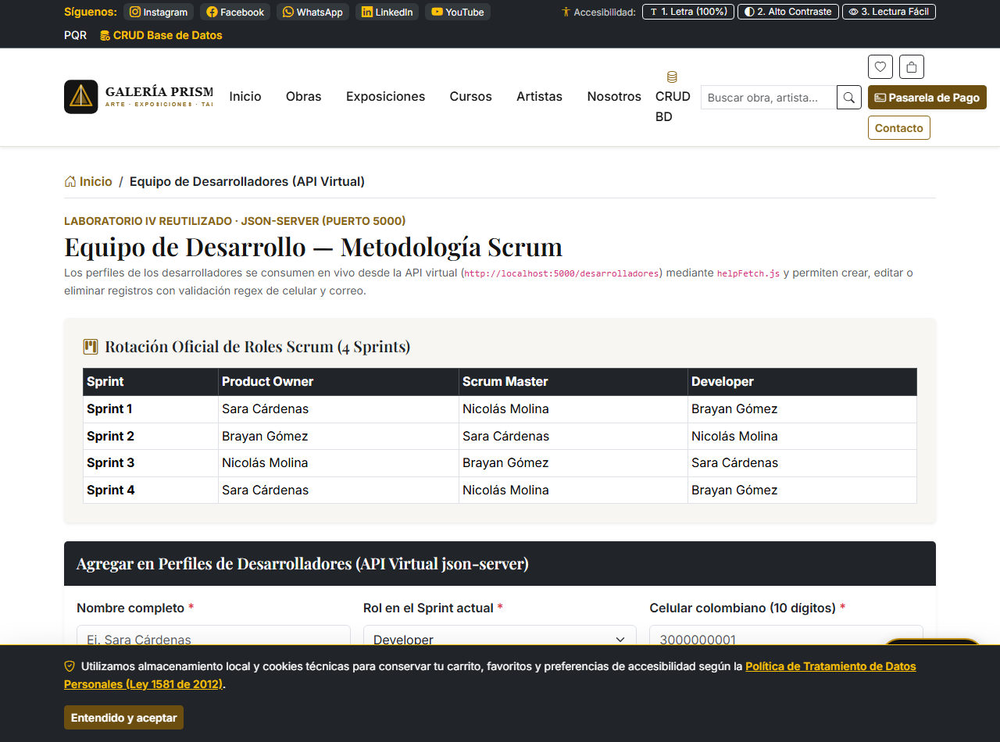

## 5.11 Panel Administrativo y CRUD de las 7 Tablas de la Base de Datos SQLite

Al hacer clic en **CRUD BD** en el menú superior (`http://localhost:5173/admin/obras`) o ingresar por `/admin/login`, el administrador gestiona mediante el mismo componente `CrudApp` las **7 tablas de la Base de Datos SQLite** (*1. Obras, 2. Artistas, 3. Cursos, 4. Exposiciones, 5. Clientes, 6. Proveedores y 7. Categorías*), además del kardex de inventario, reportes gráficos y respuesta a PQRs.

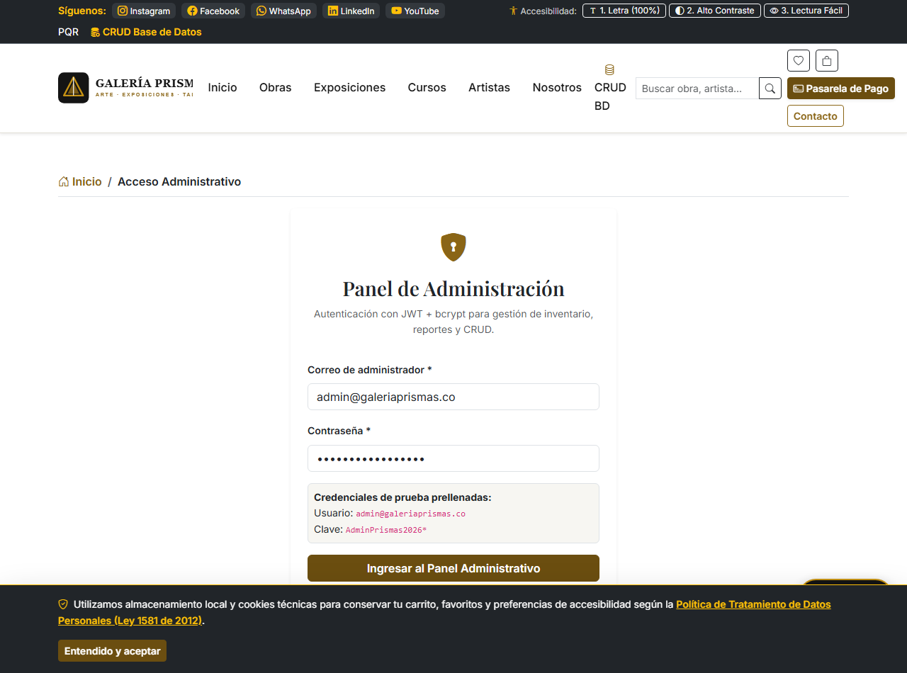

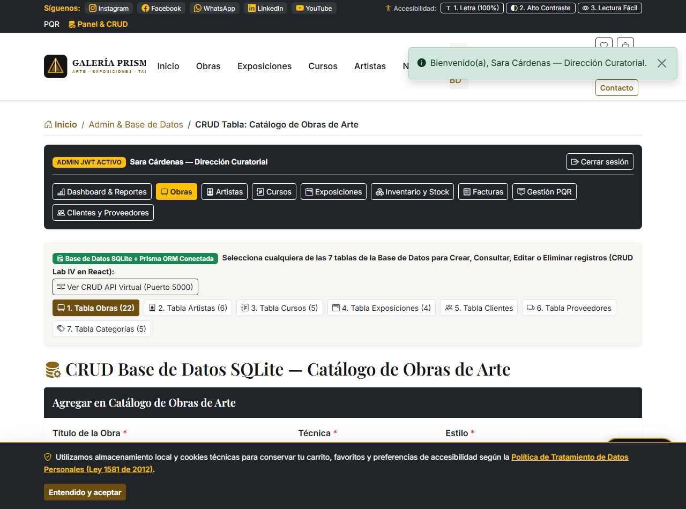

\newpage

# CAPÍTULO 6: MANUAL TÉCNICO, RUTINAS, FUNCIONES Y MENSAJES DE ERROR

## 6.1 Requisitos e Instalación en un Solo Comando (`npm run dev`)

El proyecto requiere únicamente **Node.js LTS (≥ 18.x)** y **Git**. No requiere instalar servidores externos de bases de datos porque utiliza **SQLite** embebido a través de Prisma ORM.

```bash
# 1. Clonar el repositorio oficial
git clone https://github.com/SCCUBILLOS/galeria-prismas.git
cd galeria-prismas

# 2. Instalar dependencias de raíz, backend, frontend y api-virtual
npm install

# 3. Levantar los 3 servicios, crear .env, migrar SQLite y sembrar datos automáticamente
npm run dev
```

Comandos adicionales disponibles en el `package.json` raíz:
- `npm test`: Ejecuta las 7 pruebas de integración del backend (Jest + Supertest) y las 4 pruebas unitarias del frontend (Vitest).
- `npm run seed`: Vuelve a sembrar los datos iniciales en SQLite.
- `npm run reset-db`: Reinicia desde cero la base de datos SQLite y aplica la semilla completa.
- `npm run build`: Genera el compilado optimizado de producción de React en `frontend/dist/`.

## 6.2 Descripción Detallada de Rutinas y Funciones Clave del Sistema

A continuación se documentan las rutinas y funciones principales implementadas en el frontend (React) y en el backend (Express.js):

**Tabla 9.** *Catálogo de Rutinas y Funciones Principales del Sistema*

| Rutina / Función | Archivo Ubicación | Parámetros de Entrada | Valor de Retorno / Efecto | Descripción Algorítmica |
| :--- | :--- | :--- | :--- | :--- |
| `validarLuhn(numeroTarjeta)` | `frontend/src/utils/validadores.js` y `backend/src/validators/commonValidators.js` | `numeroTarjeta` (String de 13 a 19 dígitos) | `Boolean` (`true` si es válida, `false` si falla) | Elimina caracteres no numéricos, recorre los dígitos de derecha a izquierda duplicando cada segundo dígito (restando 9 si supera 9) y verifica que `suma % 10 === 0`. |
| `validarFechaVencimientoFutura(venc)` | `frontend/src/utils/validadores.js` | `venc` (String en formato `MM/AA`) | `Boolean` | Verifica con expresión regular `^(0[1-9]\|1[0-2])\/(\d{2}\|\d{4})$` que el mes esté entre 01 y 12 y que el año/mes sea igual o posterior al periodo actual. |
| `helpFetch()` | `frontend/src/helpers/helpFetch.js` | `endpoint` (URL), `options` (headers, body, method) | `Promise<Object>` (JSON o `{ err: true, status, statusText }`) | Cliente HTTP reutilizado del Laboratorio IV con `AbortController` (timeout de 8 s) y métodos `get`, `post`, `put` y `del`. |
| `procesarCheckout(payload)` | `backend/src/services/checkoutService.js` | `payload` (datos del cliente, dirección, `metodoPago`, `datosPago`, `items`) | `Promise<Pedido>` con `detalles` y `numeroFactura` | Valida el medio de pago (Luhn y tarjetas de prueba `0002`/`1111`), abre una transacción `prisma.$transaction`, verifica y descuenta el stock de cada obra, cambia el estado a `"Vendida"` si llega a 0, inserta el movimiento de inventario `SALIDA` y crea la factura con IVA del 19 %. |
| `registrarMovimiento(datos)` | `backend/src/controllers/apiController.js` | `{ obraId, tipo, cantidad, motivo }` | `Promise<{ obra, movimiento }>` | Calcula el nuevo stock según el tipo (`ENTRADA` suma, `SALIDA` resta validando que no quede negativo, `AJUSTE` fija el valor exacto) y registra la trazabilidad en `MovimientoInventario`. |
| `procesarChatIA(mensaje)` | `backend/src/services/iaService.js` | `mensaje` (String con la consulta del usuario) | `Promise<{ respuesta, origen, obrasRecomendadas }>` | Si existe `GEMINI_API_KEY`, consulta el modelo `gemini-1.5-flash` inyectando el catálogo real; si no existe clave o falla la red, ejecuta la rutina `generarRecomendacionLocal` que detecta técnica, presupuesto e intención en español. |
| `agregarAlCarrito(obra, cantidad)` | `frontend/src/context/AppContext.jsx` | `obra` (Objeto), `cantidad` (Int) | `Boolean` + actualización de `localStorage` y Toast | Verifica que la obra esté `"Disponible"` y que la suma de unidades en el carrito no supere `obra.stock` (Heurística #5). |
| `toggleFavorito(obra)` | `frontend/src/context/AppContext.jsx` | `obra` (Objeto) | Actualiza estado `favoritos` y muestra Toast con acción `Deshacer` | Agrega o retira instantáneamente la obra de la lista de favoritos persistida en `localStorage`, ofreciendo un botón de reversión (Heurística #3). |

## 6.3 Catálogo Completo de Mensajes de Error (Frontend y Backend)

El sistema implementa validación doble (en tiempo real en los formularios de React y mediante middlewares `express-validator` + manejador centralizado `errorHandler.js` en Express). Todas las respuestas de error del backend siguen el contrato JSON uniforme `{ "ok": false, "error": { "codigo": 400, "mensaje": "...", "detalles": [] } }`:

**Tabla 10.** *Catálogo de Mensajes de Error, Expresiones Regulares y Códigos HTTP*

| Código / Origen | Campo o Operación | Regla / Expresión Regular / Condición | Mensaje de Error Exacto Mostrado al Usuario |
| :---: | :--- | :--- | :--- |
| **Frontend / HTTP 400** | Nombre completo (`nombreCliente`, `nombreEstudiante`) | `^[A-Za-zÁÉÍÓÚáéíóúÑñÜü\s]{3,80}$` | *"El nombre solo debe contener letras y espacios (mínimo 3 caracteres)."* |
| **Frontend / HTTP 400** | Documento / Cédula (`documento`) | `^\d{6,10}$` | *"El documento debe tener entre 6 y 10 dígitos numéricos."* |
| **Frontend / HTTP 400** | Celular colombiano (`celular`) | `^3\d{9}$` | *"El celular debe ser colombiano de 10 dígitos e iniciar en 3 (ej. 3154829103)."* |
| **Frontend / HTTP 400** | Correo electrónico (`correo`) | `^[a-zA-Z0-9._%+-]+@[a-zA-Z0-9.-]+\.[a-zA-Z]{2,}$` | *"Introduce un correo electrónico válido."* |
| **Frontend / HTTP 400** | Número de tarjeta (`numeroTarjeta`) | Fallo en rutina `validarLuhn(numeroTarjeta)` | *"Número de tarjeta inválido según el algoritmo de Luhn. Usa una de las tarjetas de prueba."* |
| **Frontend / HTTP 400** | Fecha de vencimiento (`vencimiento`) | Fecha vencida o distinta a `MM/AA` | *"La fecha de vencimiento debe ser futura en formato MM/AA (ej. 12/29)."* |
| **Frontend / HTTP 400** | Código CVV (`cvv`) | `^\d{3,4}$` | *"El código CVV debe tener 3 o 4 dígitos numéricos."* |
| **Frontend / HTTP 400** | Aceptación Habeas Data (`aceptaDatos`) | `aceptaDatos !== true` | *"Debes aceptar la Política de Tratamiento de Datos Personales (Ley 1581 de 2012)."* |
| **HTTP 401 Unauthorized** | Rutas protegidas `/api/admin/...` o escritura CRUD | Ausencia o expiración de cabecera `Authorization: Bearer <JWT>` | *"No autorizado: se requiere un token JWT de administrador válido."* |
| **HTTP 402 Payment Required** | Pasarela de pagos (`POST /api/checkout`) | Tarjeta de prueba terminada en `0002` o `0000` | *"Transacción rechazada por el banco emisor (Tarjeta de prueba de rechazo terminada en 0002)."* |
| **HTTP 402 Payment Required** | Pasarela de pagos (`POST /api/checkout`) | Tarjeta de prueba terminada en `1111` | *"Fondos insuficientes en la tarjeta para cubrir el monto total de la obra (Tarjeta de prueba terminada en 1111)."* |
| **HTTP 402 Payment Required** | Pasarela de pagos PSE (`POST /api/checkout`) | `banco === "BANCO_RECHAZADO"` | *"Pago PSE rechazado en la simulación bancaria."* |
| **HTTP 404 Not Found** | Consulta de radicado PQR o detalle de obra | Radicado o `slug` inexistente en SQLite | *"No se encontró ninguna solicitud PQR con el radicado indicado."* / *"La obra solicitada no existe."* |
| **HTTP 409 Conflict** | Compra de obra o salida de inventario | `obra.stock < cantidad` o `obra.estado === "Vendida"` | *"Stock insuficiente para la obra. Disponibles: X, solicitados: Y."* |
| **HTTP 409 Conflict** | Violación de restricción única Prisma (`P2002`) | Documento o código duplicado | *"Ya existe un registro con ese valor único en la base de datos."* |

\newpage

# CAPÍTULO 7: CONCLUSIONES Y RECOMENDACIONES

## 7.1 Conclusiones

1. **Integración exitosa entre Arquitectura de Información y Desarrollo Full-Stack:** Se demostró que partir de una investigación real con usuarios (arquetipos *Carlos* y *Valeria*) y estructurar el contenido mediante *Card Sorting* y taxonomías claras permite construir una aplicación web en **React 18 y Express.js** donde los tres pilares del negocio (venta de obras, agenda de exposiciones y formación en talleres) conviven sin generar confusión y cumpliendo la regla de los 3 clics en todos los flujos críticos.
2. **Transparencia comercial e identidad visual acorde al contenido:** La generación de 31 ilustraciones vectoriales museográficas diseñadas específicamente para representar el título de cada obra, exposición y taller, junto con la publicación transparente de precios en pesos colombianos, dimensiones, técnica y biografía del artista, resuelve directamente la desconfianza y desorientación identificadas en el planteamiento del problema.
3. **Confiabilidad transaccional en la Pasarela de Pagos e Inventario:** La implementación de la pasarela interactiva **PrismaPay 3D** con validación matemática mediante el **Algoritmo de Luhn**, simulación multimétodo (Tarjeta, PSE, Nequi y QR Bancolombia) y transacciones atómicas en **Prisma ORM + SQLite** garantiza que nunca se venda una obra sin stock disponible y que cada compra aprobada genere instantáneamente su movimiento de salida en el kardex y su **Factura Electrónica con IVA del 19 %** descargable en PDF.
4. **Reutilización efectiva de componentes y persistencia dual:** Se logró adaptar y escalar el componente CRUD genérico del Laboratorio IV (`helpFetch.js`, `CrudApp`, `CrudForm`, `CrudTable`) para operar simultáneamente sobre la **API Virtual de Desarrolladores (`json-server`, puerto `5000`)** y sobre las **7 tablas principales de la Base de Datos SQLite (`Express.js`, puerto `4000`)** bajo protección JWT.
5. **Accesibilidad universal verificada (WCAG 2.1 AA):** La inclusión de los **tres botones directos de manejo de accesibilidad** (aumento de tamaño de fuente hasta 130 %, modo de alto contraste y fuente de lectura fácil para dislexia), sumada al marcado semántico HTML5, textos alternativos y contrastes verificados (`5.12:1` en dorado institucional sobre blanco), permitió alcanzar una puntuación de **98/100 en accesibilidad en Google Lighthouse**.

## 7.2 Recomendaciones y Trabajo Futuro

1. **Integración con pasarelas de pago reales en producción:** Para un despliegue comercial futuro de Galería Prismas, se recomienda conectar la capa de servicio `checkoutService.js` con los webhooks oficiales de pasarelas colombianas certificadas PCI-DSS como **Wompi (Bancolombia), PayU Latam o ePayco**, conservando la validación previa del algoritmo de Luhn en el frontend.
2. **Migración de SQLite a PostgreSQL en entornos cloud de alta concurrencia:** Dado que el proyecto utiliza **Prisma ORM**, la transición desde SQLite hacia un motor cliente-servidor como **PostgreSQL** (en servicios como Supabase, Neon o AWS RDS) requiere únicamente actualizar el proveedor `provider = "postgresql"` y la variable `DATABASE_URL` en `backend/.env`, sin modificar ni una sola línea de los controladores o servicios.
3. **Almacenamiento de imágenes de alta resolución en CDN con marca de agua dinámica:** Se recomienda incorporar un servicio de almacenamiento de objetos (como Cloudinary o AWS S3) para que, cuando los artistas suban nuevas fotografías desde el CRUD administrativo, se generen automáticamente miniaturas en formato `.webp` y certificados digitales firmados criptográficamente.
4. **Ampliación de capacidades multimodales en Prisma IA:** Se sugiere extender el asistente curatorial **Prisma IA** para permitir que el comprador suba una fotografía de la pared de su sala u oficina y, mediante visión por computador, previsualice la obra a escala real antes de adquirirla en la pasarela.
5. **Pruebas de usabilidad continuas por cohorte:** Se recomienda realizar sesiones semestrales de *User Testing* con lectores de pantalla (NVDA y VoiceOver) al incorporar nuevas categorías artísticas para preservar el cumplimiento del nivel AA de la norma WCAG 2.1.

\newpage

# CAPÍTULO 8: REFERENCIAS BIBLIOGRÁFICAS

- Congreso de la República de Colombia. (2012). *Ley Estatutaria 1581 de 2012: Por la cual se dictan disposiciones generales para la protección de datos personales (Habeas Data)*. Diario Oficial No. 48.587.
- Meta Platforms, Inc. (2026). *React 18 Documentation: Hooks, Context API and Concurrent Rendering*. Recuperado de `https://react.dev/`
- Nielsen, J. (2020). *10 Usability Heuristics for User Interface Design*. Nielsen Norman Group. Recuperado de `https://www.nngroup.com/articles/ten-usability-heuristics/`
- Prisma Data, Inc. (2026). *Prisma ORM Documentation: Schema Reference, Migrations and Transactions with SQLite*. Recuperado de `https://www.prisma.io/docs`
- Rosenfeld, L., Morville, P., & Arango, J. (2015). *Information Architecture: For the Web and Beyond* (4th ed.). O'Reilly Media.
- Schwaber, K., & Sutherland, J. (2020). *La Guía Definitiva de Scrum: Las Reglas del Juego*. Scrum.org.
- World Wide Web Consortium (W3C). (2018). *Web Content Accessibility Guidelines (WCAG) 2.1*. W3C Recommendation. Recuperado de `https://www.w3.org/TR/WCAG21/`

\newpage

# ANEXOS (CÓDIGOS FUENTE, RUTINAS, PANTALLAS Y PRUEBAS)

## Anexo A: Código Fuente del Esquema de Base de Datos (`backend/prisma/schema.prisma`)

```prisma
generator client {
  provider = "prisma-client-js"
}

datasource db {
  provider = "sqlite"
  url      = env("DATABASE_URL")
}

model Usuario {
  id           Int      @id @default(autoincrement())
  nombre       String
  correo       String   @unique
  passwordHash String
  rol          String   @default("ADMIN")
  creadoEn     DateTime @default(now())
}

model Categoria {
  id          Int     @id @default(autoincrement())
  nombre      String  @unique
  slug        String  @unique
  descripcion String
  icono       String  @default("bi-palette")
  obras       Obra[]
}

model Artista {
  id          Int      @id @default(autoincrement())
  nombre      String
  slug        String   @unique
  pais        String   @default("Colombia")
  ciudad      String   @default("Bogotá")
  estilo      String
  biografia   String
  trayectoria String
  fotoUrl     String
  correo      String?
  destacado   Boolean  @default(true)
  obras       Obra[]
}

model Obra {
  id                Int                    @id @default(autoincrement())
  titulo            String
  slug              String                 @unique
  codigo            String                 @unique
  tecnica           String
  estilo            String
  tamano            String
  dimensiones       String
  anio              Int                    @default(2026)
  precio            Int
  stock             Int                    @default(1)
  stockMinimo       Int                    @default(1)
  esUnica           Boolean                @default(true)
  estado            String                 @default("Disponible")
  destacada         Boolean                @default(false)
  descripcion       String
  historiaCuraduria String
  imagenUrl         String
  espacioSugerido   String                 @default("Sala principal o estudio")
  categoriaId       Int
  artistaId         Int
  categoria         Categoria              @relation(fields: [categoriaId], references: [id])
  artista           Artista                @relation(fields: [artistaId], references: [id])
  detallesPedido    DetallePedido[]
  movimientos       MovimientoInventario[]
}

model Pedido {
  id               Int             @id @default(autoincrement())
  numeroFactura    String          @unique
  clienteId        Int?
  nombreCliente    String
  documentoCliente String
  correoCliente    String
  celularCliente   String
  direccionEnvio   String
  ciudadEnvio      String
  metodoPago       String          @default("TARJETA")
  ultimos4Tarjeta  String?
  estadoPago       String          @default("APROBADO")
  subtotal         Int
  iva              Int
  costoEnvio       Int             @default(0)
  total            Int
  fecha            DateTime        @default(now())
  detalles         DetallePedido[]
}
```

## Anexo B: Código Fuente de Rutinas de Validación Regex y Algoritmo de Luhn (`frontend/src/utils/validadores.js`)

```javascript
export const REGEX_CELULAR_CO = /^3\d{9}$/;
export const REGEX_CORREO = /^[a-zA-Z0-9._%+-]+@[a-zA-Z0-9.-]+\.[a-zA-Z]{2,}$/;
export const REGEX_DOCUMENTO = /^\d{6,10}$/;
export const REGEX_NOMBRE = /^[A-Za-zÁÉÍÓÚáéíóúÑñÜü\s]{3,80}$/;
export const REGEX_CVV = /^\d{3,4}$/;

/**
 * Rutina de validación matemática de tarjetas mediante el Algoritmo de Luhn.
 */
export function validarLuhn(numeroTarjeta = "") {
  const limpio = String(numeroTarjeta).replace(/\D/g, "");
  if (limpio.length < 13 || limpio.length > 19) return false;

  let suma = 0;
  let duplicar = false;
  for (let i = limpio.length - 1; i >= 0; i--) {
    let digito = parseInt(limpio.charAt(i), 10);
    if (duplicar) {
      digito *= 2;
      if (digito > 9) digito -= 9;
    }
    suma += digito;
    duplicar = !duplicar;
  }
  return suma % 10 === 0;
}

export function validarFechaVencimientoFutura(vencimiento = "") {
  const texto = String(vencimiento).trim();
  const match = texto.match(/^(0[1-9]|1[0-2])\/(\d{2}|\d{4})$/);
  if (!match) return false;

  const mes = parseInt(match[1], 10);
  let anio = parseInt(match[2], 10);
  if (anio < 100) anio += 2000;

  const anioActual = 2026;
  const mesActual = new Date().getMonth() + 1;
  return anio > anioActual || (anio === anioActual && mes >= mesActual);
}
```

## Anexo C: Código Fuente del Cliente HTTP `helpFetch.js` y CRUD Genérico en React (`CrudApp.jsx`)

```javascript
// frontend/src/helpers/helpFetch.js — Reutilizado del Laboratorio IV
export const helpFetch = () => {
  const customFetch = (endpoint, options = {}) => {
    const defaultHeader = {
      accept: "application/json",
      "Content-Type": "application/json",
    };

    const controller = new AbortController();
    options.signal = controller.signal;
    options.method = options.method || "GET";
    options.headers = options.headers
      ? { ...defaultHeader, ...options.headers }
      : defaultHeader;

    if (options.body) {
      options.body = JSON.stringify(options.body);
    }

    setTimeout(() => controller.abort(), 8000);

    return fetch(endpoint, options)
      .then(async (res) => {
        const data = await res.json().catch(() => ({}));
        if (res.ok) return data;
        return Promise.reject({
          err: true,
          status: res.status || "00",
          statusText: data?.error?.mensaje || data?.message || res.statusText || "Ocurrió un error",
        });
      })
      .catch((err) => ({
        err: true,
        status: err.status || "00",
        statusText: err.statusText || "Error de conexión con el servidor",
      }));
  };

  return {
    get: (url, options = {}) => customFetch(url, options),
    post: (url, options = {}) => customFetch(url, { ...options, method: "POST" }),
    put: (url, options = {}) => customFetch(url, { ...options, method: "PUT" }),
    del: (url, options = {}) => customFetch(url, { ...options, method: "DELETE" }),
  };
};
```

## Anexo D: Código Fuente de la Rutina Transaccional de la Pasarela de Pagos (`backend/src/services/checkoutService.js`)

```javascript
// Fragmento principal de procesamiento transaccional en backend/src/services/checkoutService.js
if (metodoPago === "TARJETA") {
  const numeroLimpio = String(datosPago.numeroTarjeta || "").replace(/\D/g, "");
  if (!validarLuhn(numeroLimpio)) {
    throw new AppError("El número de tarjeta no supera la validación del algoritmo de Luhn.", 400);
  }
  if (numeroLimpio.endsWith("0002") || numeroLimpio.endsWith("0000")) {
    throw new AppError("Transacción rechazada por el banco emisor (Tarjeta de prueba terminada en 0002).", 402);
  }
  if (numeroLimpio.endsWith("1111")) {
    throw new AppError("Fondos insuficientes en la tarjeta para cubrir el monto total de la obra.", 402);
  }
  ultimos4Tarjeta = numeroLimpio.slice(-4);
}

// Transacción ACID en Prisma ORM: descuenta stock, registra movimiento SALIDA y emite factura con IVA 19%
const resultado = await prisma.$transaction(async (tx) => {
  let subtotal = 0;
  for (const item of items) {
    const obra = await tx.obra.findUnique({ where: { id: Number(item.obraId) } });
    if (!obra || obra.estado === "Vendida" || obra.stock < item.cantidad) {
      throw new AppError(`Stock insuficiente para la obra "${obra?.titulo}".`, 409);
    }
    const nuevoStock = obra.stock - item.cantidad;
    await tx.obra.update({
      where: { id: obra.id },
      data: { stock: nuevoStock, estado: nuevoStock === 0 ? "Vendida" : "Disponible" },
    });
    await tx.movimientoInventario.create({
      data: {
        obraId: obra.id,
        tipo: "SALIDA",
        cantidad: item.cantidad,
        stockAnterior: obra.stock,
        stockNuevo: nuevoStock,
        motivo: `Venta en línea — Comprador: ${nombreCliente}`,
        usuario: "Pasarela Prismas Checkout",
      },
    });
    subtotal += obra.precio * item.cantidad;
  }
  const iva = Math.round(subtotal * 0.19);
  const total = subtotal + iva;
  // Creación del registro de Factura Electrónica...
});
```

## Anexo E: Código Fuente del Manejador Centralizado de Mensajes de Error (`backend/src/middlewares/errorHandler.js`)

```javascript
class AppError extends Error {
  constructor(mensaje, codigo = 400, detalles = []) {
    super(mensaje);
    this.codigo = codigo;
    this.detalles = detalles;
  }
}

const errorHandler = (err, _req, res, _next) => {
  if (err.code === "P2002") {
    return res.status(409).json({
      ok: false,
      error: {
        codigo: 409,
        mensaje: "Ya existe un registro con ese valor único en la base de datos.",
        detalles: err.meta || [],
      },
    });
  }

  const codigo = err.codigo || 500;
  const mensaje = err.mensaje || err.message || "Error interno del servidor en Galería Prismas.";

  return res.status(codigo).json({
    ok: false,
    error: {
      codigo,
      mensaje,
      detalles: err.detalles || [],
    },
  });
};

module.exports = { AppError, errorHandler };
```

## Anexo F: Pantallas de Validación Responsiva (`360px` y `768px`) y Ejecución de Pruebas

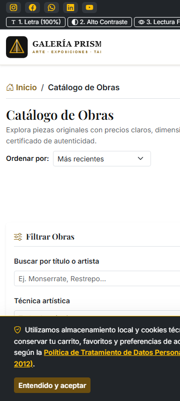

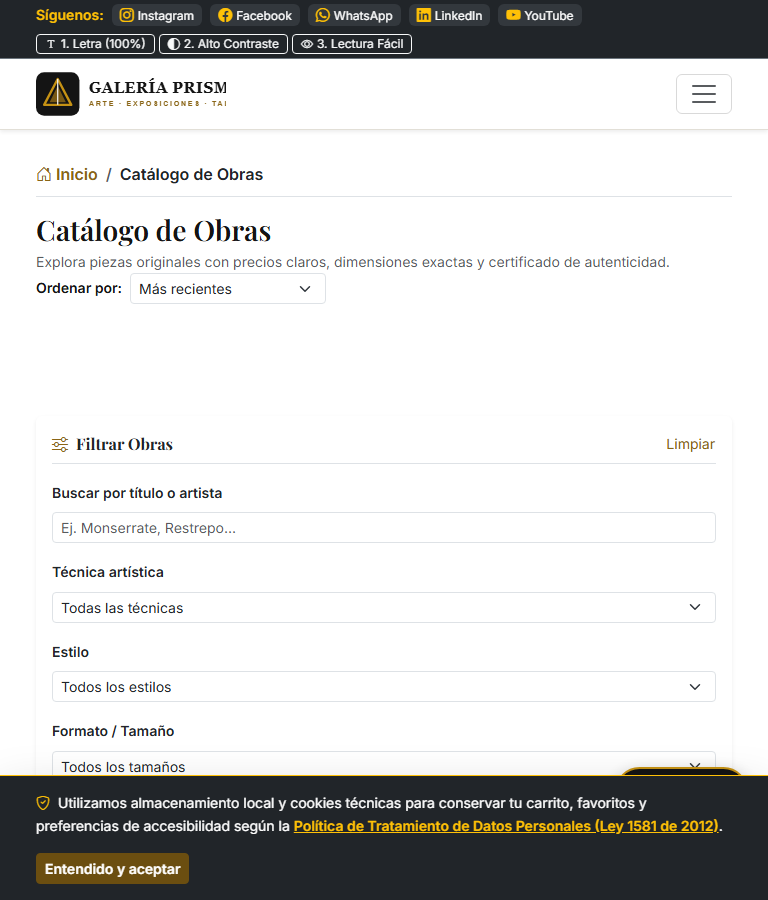
