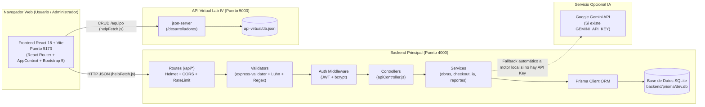
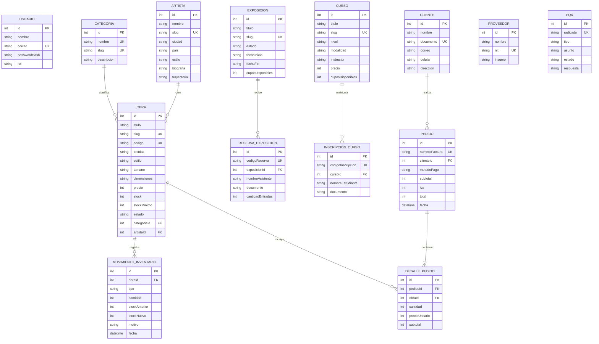
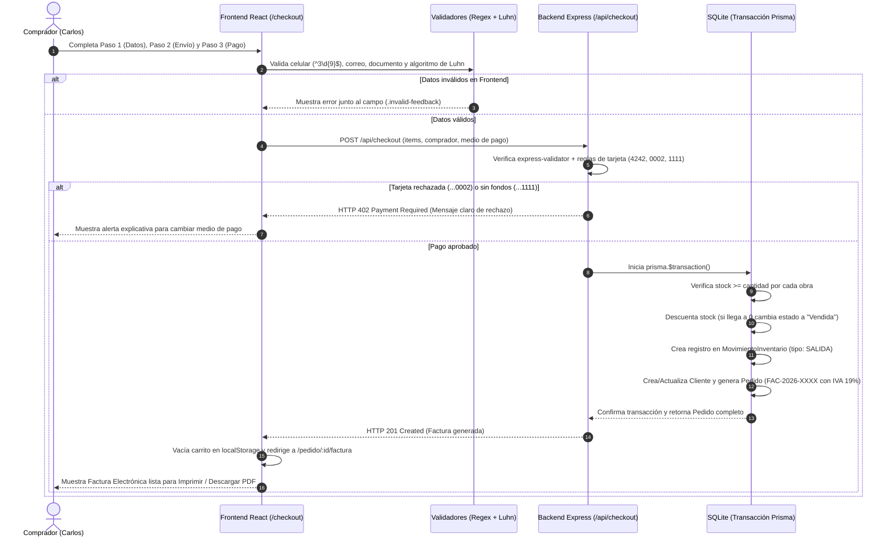

# Arquitectura Técnica — Galería Prismas

**Autores:** Sara Cárdenas, Nicolás Molina, Brayan Gómez  
**Asignaturas:** Programación Web y Arquitectura de Información — Universidad Libre (2026-II)

---

## 1. Arquitectura Distribuida de 3 Servicios (Monorepo)

El sistema se ejecuta localmente con un único comando (`npm run dev`) orquestado por `concurrently`, levantando 3 servicios independientes:

1. **Frontend (`http://localhost:5173`):** SPA en React 18 + Vite + React Router 6 + Bootstrap 5 + Context API (`AppContext.jsx`).
2. **Backend Principal (`http://localhost:4000/api`):** API REST en Node.js + Express.js separada en capas (`routes/`, `controllers/`, `services/`, `middlewares/`, `validators/`), conectada a **SQLite** mediante **Prisma ORM**.
3. **API Virtual de Desarrolladores (`http://localhost:5000/desarrolladores`):** Servicio REST simulado con `json-server` consumido desde `/equipo` mediante el helper `helpFetch.js` y el CRUD genérico del Laboratorio IV.

---

## 2. Modelo Entidad-Relación de la Base de Datos (Prisma + SQLite)

---

## 3. Diagrama de Secuencia del Flujo de Compra, Descuento de Stock y Facturación

