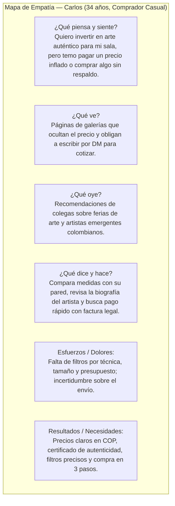
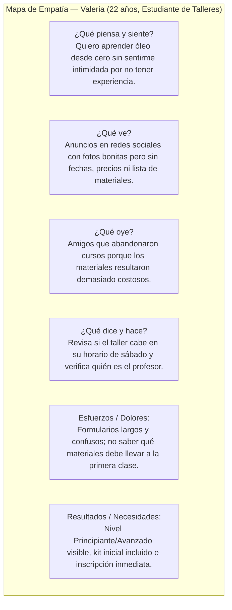

# 01. Investigación de Usuarios — Galería Prismas

**Asignatura:** Arquitectura de Información ("Proyecto de Aula") — Peso: **15 %**  
**Autores:** Sara Cárdenas, Nicolás Molina, Brayan Gómez  
**Institución:** Universidad Libre — Facultad de Ingeniería, Ingeniería de Sistemas (2026-II)

---

## 1. Planteamiento del Problema

Los usuarios interesados en el arte en Colombia se sienten **abrumados o desorientados** cuando intentan comprar obras originales, consultar la programación de exposiciones o inscribirse a talleres prácticos en internet. Las galerías tradicionales suelen publicar catálogos sin precios visibles, omiten las dimensiones exactas o mezclan en un solo muro redes sociales, eventos pasados y talleres sin especificar materiales ni horarios. Como resultado, no existe una plataforma digital unificada que organice esa oferta de forma **clara, intuitiva y accesible**.

---

## 2. Metodología de Investigación

Se aplicó una metodología mixta centrada en el usuario con **15 participantes** (5 compradores/coleccionistas casuales, 6 estudiantes universitarios interesados en talleres artísticos y 4 entusiastas culturales que asisten a exposiciones en Bogotá):

1. **Encuestas estructuradas en línea ($n = 15$):** Evaluación de hábitos de búsqueda de obras, barreras de confianza en compras en línea, presupuesto promedio y preferencias de horario para cursos.
2. **Entrevistas semiestructuradas (6 sesiones de 25 minutos):** Indagación sobre frustraciones al navegar sitios de galerías, vocabulario esperado (técnica, soporte, curaduría) y expectativas frente al proceso de pago o inscripción.

### Hallazgos Cuantitativos Clave
- El **86,7 %** (13 de 15) abandona una página de galería si el **precio** y el **estado de disponibilidad** (`Disponible` / `Vendida`) no aparecen de inmediato.
- El **80 %** de los interesados en talleres necesita conocer antes de inscribirse **qué materiales incluye el curso**, el **nivel requerido** y la **biografía del instructor**.
- El **73,3 %** prefiere que la **venta de obras**, la **agenda de exposiciones** y los **cursos/talleres** estén claramente separados en el menú principal.

---

## 3. Arquetipos de Usuario (User Personas) y Mapas de Empatía

### Persona 1: Carlos Andrés Mendoza (34 años) — Comprador / Coleccionista Casual
- **Ocupación:** Arquitecto consultor en Bogotá.
- **Objetivo:** Buscar piezas únicas (pinturas al óleo, acrílico o esculturas) para su casa u oficina sin intermediarios opacos.
- **Frustraciones:** Le preocupan la autenticidad de las piezas y los precios inflados. Le cuesta filtrar por rango de precio, dimensiones o estilo.
- **Necesidades:** Encontrar rápido obras disponibles con precio en COP, ficha técnica, dimensiones reales y trayectoria del artista.

---

### Persona 2: Valeria Sofía Castellanos (22 años) — Estudiante de Talleres
- **Ocupación:** Estudiante universitaria en Bogotá.
- **Objetivo:** Aprender técnicas de pintura (óleo, acrílico y acuarela) en su tiempo libre.
- **Frustraciones:** Cursos que no aclaran si son para principiantes, horarios rígidos y costos ocultos de materiales.
- **Necesidades:** Horarios flexibles (sábados o noches virtuales), niveles explícitos, lista transparente de materiales incluidos/requeridos, trayectoria del instructor e inscripción en pocos pasos.

---

## 4. Insights Accionables y Cómo los Refleja la Plataforma

| Insight de Investigación | Implementación Concreta en Galería Prismas | Ruta / Evidencia |
| :--- | :--- | :--- |
| **Insight 1:** Separar claramente venta de obras, agenda de exposiciones y talleres. | Menú global sticky con secciones independientes (`Obras`, `Exposiciones`, `Cursos`, `Artistas`, `Nosotros`) y bloque de 3 pilares en Inicio. | `/`, `/obras`, `/exposiciones`, `/cursos` |
| **Insight 2:** Mostrar precios, disponibilidad, detalles técnicos y biografía del artista genera confianza (Carlos). | Cada `ObraCard` y vista de detalle muestra precio en COP, badge `Disponible`/`Vendida`, dimensiones exactas, código curatorial y perfil del artista. | `/obras`, `/obras/detalle/:slug`, `/artistas/:slug` |
| **Insight 3:** Especificar horarios, niveles, materiales e instructor antes de la inscripción (Valeria). | Ficha del taller estructurada en 4 bloques numerados: Horarios/Modalidad, Materiales incluidos, Contenido/Temario y Trayectoria del Instructor. | `/cursos`, `/cursos/:id` |
| **Insight 4:** La inscripción, la reserva y la compra deben tener pocos pasos. | Inscripción a curso y reserva de exposición en 1 paso en la misma vista; checkout de compra guiado en 3 pasos con barra de progreso. | `/cursos/:id`, `/exposiciones/:id`, `/checkout` |
