# 02. Arquitectura de Información — Galería Prismas

**Asignatura:** Arquitectura de Información ("Proyecto de Aula") — Peso: **15 %**  
**Autores:** Sara Cárdenas, Nicolás Molina, Brayan Gómez

---

## 1. Resultados del Card Sorting (Abierto y Cerrado)

Se realizó una sesión de **Card Sorting** con 24 tarjetas de contenido e interacción. Los participantes agruparon las tarjetas en **4 grandes categorías mentales** con un acuerdo superior al 88 %:

| Categoría Mental | Tarjetas Agrupadas por los Usuarios | Ruta Principal |
| :--- | :--- | :--- |
| **1. Obras de Arte** | Pinturas al óleo, Acrílicos, Esculturas, Fotografía, Arte Digital, Novedades/Destacados, Ficha técnica y precio. | `/obras` |
| **2. Exposiciones y Eventos** | Exposiciones en curso, Próximas inauguraciones, Exposiciones pasadas (archivo), Calendario de temporada, Reserva de entradas. | `/exposiciones` |
| **3. Cursos y Talleres** | Oferta de talleres, Nivel Principiante/Intermedio/Avanzado, Modalidad Presencial/Virtual, Lista de materiales, Horarios e Inscripciones. | `/cursos` |
| **4. Galería / Nosotros** | Historia y misión de la galería, Directorio de artistas y biografías, Contacto, Mapa y horarios, Sistema PQR, Equipo desarrollador. | `/nosotros`, `/artistas`, `/contacto` |

---

## 2. Sistemas de Organización y Taxonomías Facetadas

Para responder tanto a búsquedas exploratorias como a búsquedas específicas (Carlos y Valeria), se diseñó una **taxonomía facetada** en tres ejes ortogonales:

1. **Por Tipo de Contenido (Esquema Exacto):**
   - `Obras` · `Eventos / Exposiciones` · `Cursos y Talleres` · `Artistas`
2. **Por Técnica Artística (Esquema Temático del Dominio):**
   - `Óleo` · `Acrílico` · `Escultura` · `Digital` · `Fotografía`
3. **Por Estado Operativo (Esquema Funcional):**
   - **Obras:** `Disponible` | `Vendida`
   - **Cursos:** `Presencial` | `Virtual` (y por nivel: `Principiante` | `Intermedio` | `Avanzado`)
   - **Exposiciones:** `Próximo` | `En curso` | `Finalizado`

---

## 3. Mapa del Sitio (Sitemap Jerárquico)

```mermaid
flowchart TD
    Root["/ Inicio (Galería Prismas)"]
    
    Root --> Obras["/obras Catálogo de Obras"]
    Obras --> Tecnica["/obras/:tecnica (Óleo, Acrílico, Escultura, Fotografía, Digital)"]
    Obras --> DetalleObra["/obras/detalle/:slug (Ficha Curatorial + Obras Relacionadas)"]
    
    Root --> Expos["/exposiciones (Próximas, En Curso, Pasadas y Calendario)"]
    Expos --> ReservaExpo["/exposiciones/:id (Detalle y Reserva de Entradas)"]
    
    Root --> Cursos["/cursos Catálogo de Cursos y Talleres"]
    Cursos --> DetalleCurso["/cursos/:id (Horarios, Materiales, Temario e Instructor)"]
    DetalleCurso --> Inscripcion["/cursos/:id/inscripcion (Formulario de Matrícula)"]
    
    Root --> Artistas["/artistas Directorio de Artistas"]
    Artistas --> DetalleArtista["/artistas/:slug (Biografía, Trayectoria y Obras)"]
    
    Root --> Nosotros["/nosotros (Acordeón Empresarial y Mapa Google Maps)"]
    Nosotros --> Contacto["/contacto (Canales de Atención)"]
    Nosotros --> Equipo["/equipo (API Virtual json-server con CRUD)"]
    Nosotros --> PQR["/pqr (Radicación y Consulta por Radicado)"]
    Nosotros --> Legal["/politica-de-datos (Ley 1581 de 2012) & /preguntas-frecuentes"]
    
    Root --> Utilitaria["Navegación Utilitaria"]
    Utilitaria --> Buscar["/buscar?q= (Resultados Agrupados)"]
    Utilitaria --> Favoritos["/favoritos (Mis Obras Guardadas)"]
    Utilitaria --> Carrito["/carrito -> /checkout -> /pedido/:id/factura"]
    
    Root --> Admin["/admin Panel Administrativo (JWT)"]
    Admin --> AdminModulos["/admin/obras · /artistas · /cursos · /exposiciones · /inventario · /facturas · /pqr · /clientes"]
```

---

## 4. Sistema de Navegación y Búsqueda

| Subsistema | Implementación en Galería Prismas | Ubicación en Código |
| :--- | :--- | :--- |
| **Navegación Global** | Header sticky (`position: sticky; top: 0`) con logotipo y menús: `Inicio`, `Obras`, `Exposiciones`, `Cursos`, `Artistas`, `Nosotros`. | [`Header.jsx`](../../frontend/src/components/layout/Header.jsx) |
| **Navegación Utilitaria** | Barra superior derecha con buscador (lupa + atajo `/`), `Favoritos` (corazón con contador), `Carrito` (bolsa con contador) y botón `Contacto`. | [`Header.jsx`](../../frontend/src/components/layout/Header.jsx) |
| **Navegación Contextual** | Migas de pan (`Breadcrumbs`) en todas las vistas internas, ej.: `Inicio > Catálogo > Óleo > "Atardecer Urbano en Monserrate"`. | [`Breadcrumbs.jsx`](../../frontend/src/components/common/Breadcrumbs.jsx) |
| **Navegación Local** | Panel lateral sticky en `/obras` con filtros combinables de Precio, Técnica, Estilo, Tamaño y Estado, más selector de ordenamiento. | [`CatalogoObrasPage.jsx`](../../frontend/src/pages/CatalogoObrasPage.jsx) |
| **Búsqueda Global** | Autocompletado asíncrono desde 2 caracteres y vista `/buscar?q=` con resultados agrupados en `Obras`, `Artistas`, `Cursos` y `Exposiciones`. | [`PqrLegalFaqSearch404Pages.jsx`](../../frontend/src/pages/PqrLegalFaqSearch404Pages.jsx) |

### Justificación Arquitectónica
Se adoptó un **modelo jerárquico polijerárquico centrado en el usuario** que garantiza el cumplimiento estricto de la **regla de los 3 clics**: cualquier usuario puede llegar desde el Inicio hasta la compra de una obra, la reserva de una exposición o la inscripción a un taller en un máximo de 2 a 3 clics.
