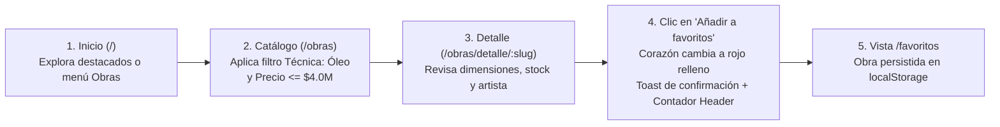
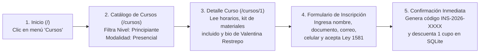
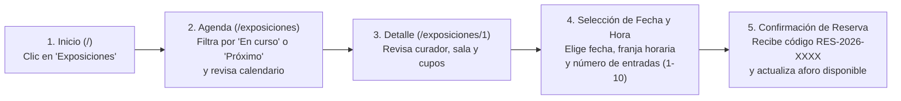
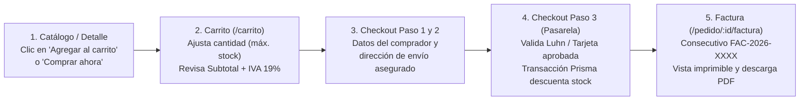

# 03. Diseño de la Interacción y Wireflows — Galería Prismas

**Asignatura:** Arquitectura de Información ("Proyecto de Aula") — Peso: **15 %**  
**Autores:** Sara Cárdenas, Nicolás Molina, Brayan Gómez

---

## 1. Flujo 1: Añadir Obra a Favoritos
**Recorrido:** `Inicio (/) → Catálogo (/obras) → Filtros (técnica/precio) → Detalle de obra (/obras/detalle/:slug) → "Añadir a favoritos"` (el corazón cambia de estado al instante y actualiza el contador del header).



---

## 2. Flujo 2: Inscripción a Curso o Taller (Persona: Valeria)
**Recorrido:** `Inicio (/) → Cursos (/cursos) → Seleccionar curso → Ver horarios, contenido y materiales (/cursos/:id) → "Inscribirme" → Formulario → Confirmación`.



---

## 3. Flujo 3: Reserva de Entradas a Exposición
**Recorrido:** `Inicio (/) → Exposiciones (/exposiciones) → Próximas / En curso → Seleccionar evento (/exposiciones/:id) → Fecha/hora → Confirmar entradas`.



---

## 4. Flujo 4: Compra de Obra y Facturación Electrónica (Persona: Carlos)
**Recorrido:** `Catálogo (/obras) → Detalle (/obras/detalle/:slug) → Agregar al carrito → Carrito (/carrito) → Checkout en 3 pasos (/checkout) → Pasarela ficticia → Factura PDF (/pedido/:id/factura)`.



---

## 5. Wireframes de Fidelidad Media de las Pantallas Clave

### 5.1 Wireframe — Catálogo de Obras con Filtros Laterales (`/obras`)
```text
+-----------------------------------------------------------------------------------+
| [LOGO GALERÍA PRISMAS]   Inicio | Obras | Exposiciones | Cursos | Artistas | [🔍] ♥ 🛍️ |
+-----------------------------------------------------------------------------------+
| Inicio > Catálogo de Obras > Óleo                                  Ordenar: [▼]   |
+-----------------------+-----------------------------------------------------------+
| FILTRAR OBRAS [Limpiar| Mostrando 22 obras                   [Técnica: Óleo]      |
|                       | +-----------------+ +-----------------+ +---------------+ |
| Buscar: [___________] | | [Disp.] [Óleo] ♥| | [Disp.] [Acr.] ♥| | [Disp.][Esc.]♥| |
| Técnica:[Óleo      ▼] | |   IMAGEN OBRA   | |   IMAGEN OBRA   | |  IMAGEN OBRA  | |
| Estilo: [Todos     ▼] | | Atardecer Urbano| | Cartografía Dor.| | Equilibrio... | |
| Tamaño: [Todos     ▼] | | Por V. Restrepo | | Por M. Villamiz.| | Por S. Duarte | |
| Estado: [Disponible▼] | | $ 3.850.000 COP | | $ 3.200.000 COP | | $ 4.600.000   | |
| Precio: [====o----]   | | [Agregar][Ver]  | | [Agregar][Ver]  | | [Agregar][Ver]| |
+-----------------------+-----------------------------------------------------------+
```

### 5.2 Wireframe — Checkout en 3 Pasos (`/checkout`)
```text
+-----------------------------------------------------------------------------------+
| AVISO: Pasarela de demostración, no se procesan pagos reales.                     |
+-----------------------------------------------------------------------------------+
| [1. Datos del Comprador] ========> [2. Envío Asegurado] ========> [3. Pago]       |
+---------------------------------------------------+-------------------------------+
| PASO 3: MEDIO DE PAGO                             | RESUMEN DEL PEDIDO            |
| (•) Tarjeta Crédito/Débito  ( ) PSE  ( ) Nequi    | - Atardecer Urbano  $3.850.000|
|                                                   | Subtotal:           $3.850.000|
| [Usar Aprobada 4242] [Rechazada 0000] [Fondos 1111| IVA (19 %):           $731.500|
| Número Tarjeta (Luhn): [4242424242424242        ] | Envío asegurado:        $0 COP|
| Vencimiento (MM/AA):   [12/29]   CVV: [842]       | ----------------------------- |
| [x] Acepto Política de Tratamiento de Datos (1581)| TOTAL A PAGAR:      $4.581.500|
| [← Volver a envío]     [Pagar y emitir factura]   |                               |
+---------------------------------------------------+-------------------------------+
```
